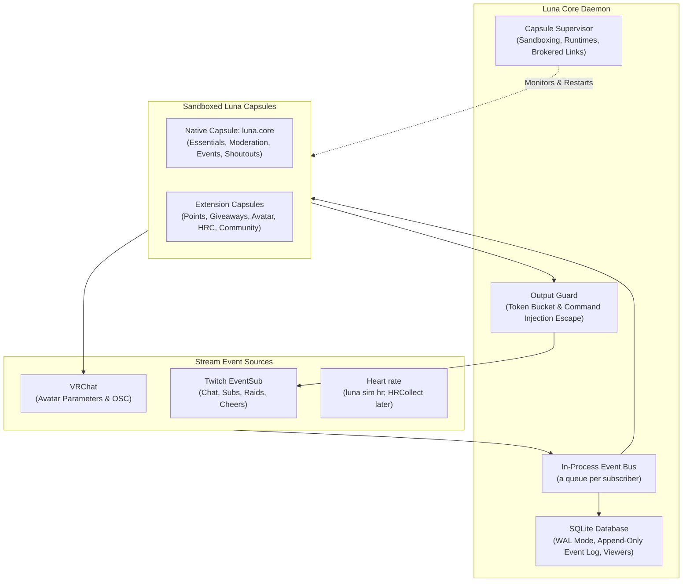

# Luna Documentation Hub

Welcome to the comprehensive documentation suite for **Luna**, the self-hosted, event-bus-driven Twitch streaming bot with native VR avatar OSC synchronization, biometric heart rate telemetry, and sandboxed plugin capsules.

---

## 1. Documentation Index

The documentation is organized into modular guides covering every layer of the Luna platform:

| Document | Topic | Target Audience |
| --- | --- | --- |
| [**Architecture**](architecture.md) | In-depth core daemon architecture, event bus ring buffer, output guard, SQLite engine, and Twitch/OSC adapters. | Systems Engineers, Contributors |
| [**Capsules Runtime & Sandbox**](capsules-runtime.md) | Complete Luna Capsules Spec v0.1: Linux/Windows sandboxing backends, Landlock, AppContainers, socket triad, CBOR framing, and brokered RPC links. | Systems Engineers, Plugin Authors |
| [**CLI Reference Manual**](cli-reference.md) | Exhaustive command-line reference: daemon control, setup wizard, authentication, config management, simulation, and stream tools. | Streamers, Operators |
| [**SDK & Plugin Development**](sdk-development.md) | Writing plugins in Python, TypeScript, and Go. Decorators, typed store, inter-capsule links, timers, and the in-process test harness. | Plugin Developers |
| [**Plugins Catalog**](plugins-catalog.md) | Reference for the first-party plugins: Core Bundle (Essentials, Moderation, Events, Shoutouts), Points, Giveaways, Stream Tools, Avatar, and Heart Rate. | Streamers, Moderators |
| [**Permissions & Governance**](permissions-and-ranks.md) | 5-tier rank ladder (Broadcaster, Head Mod, Luna Mod, Moderator, Viewer), the timeline, override rules, and capabilities. | Streamers, Moderators |
| [**Security & Sandboxing**](security-and-sandboxing.md) | Threat model, elimination of exploit primitives (injection, path traversal, ReDoS), secrets storage, and peer credential verification. | Security Auditors, DevOps |
| [**Performance & Budgets**](performance-and-budgets.md) | Memory and latency budgets ($\le 30\text{ MB}$ core RAM, $< 2\text{ ms}$ event latency), what's measured so far, and what keeps Luna small. | Performance Engineers |
| [**Configuration Reference**](configuration-reference.md) | Annotated reference for `luna.toml`, schema validation rules, live hot-reloading semantics, and per-plugin configuration blocks. | Streamers, Operators |
| [**Integrations Guide**](integrations-guide.md) | Step-by-step setup for Twitch, VRChat OSC, the heart rate plugin, and the systemd user service. | Streamers, Sysadmins |

---

## 2. Recommended Reading Paths

### 🎙️ For Streamers & Channel Operators
1. Start with the project [**README.md**](../README.md) for quick-start installation and setup.
2. Read the [**Integrations Guide**](integrations-guide.md) to link Twitch and VRChat OSC.
3. Review the [**Plugins Catalog**](plugins-catalog.md) to discover built-in commands (`!cmd`, `!quote`, `!nuke`, `!giveaway`, `!so`).
4. Keep the [**CLI Reference Manual**](cli-reference.md) and [**Configuration Reference**](configuration-reference.md) handy for operational adjustments.

### 💻 For Plugin Developers
1. Follow the [**SDK & Plugin Development Guide**](sdk-development.md) to scaffold your first plugin in Python, TypeScript, or Go.
2. Read the [**Capsules Runtime Specification**](capsules-runtime.md) to understand how sandboxing, permissions, and inter-capsule RPC links operate.
3. Review the [**Architecture**](architecture.md) guide to understand event flows and the gRPC Host API.

### 🛡️ For Security & Systems Engineers
1. Inspect the [**Security Architecture & Threat Model**](security-and-sandboxing.md) for exploit prevention mechanics.
2. Review the [**Permissions & Governance**](permissions-and-ranks.md) specification for the rank ladder and override rules.
3. Examine the [**Performance Engineering & Budgets**](performance-and-budgets.md) document to verify how Luna satisfies its release gates.

---

## 3. High-Level Architecture Overview

