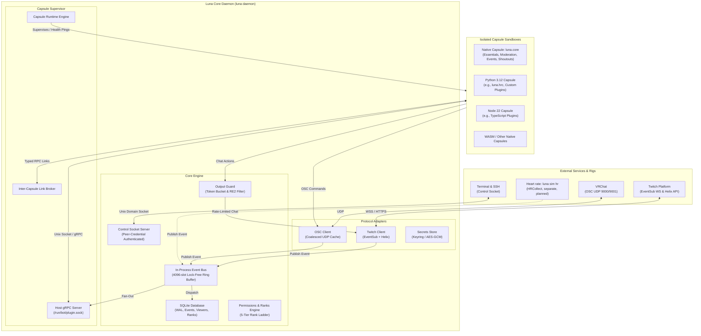
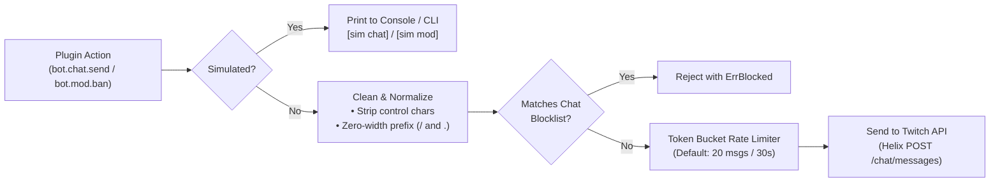
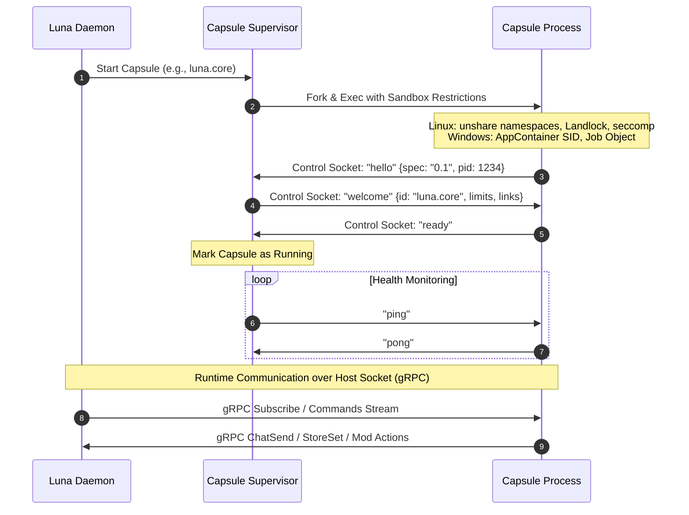
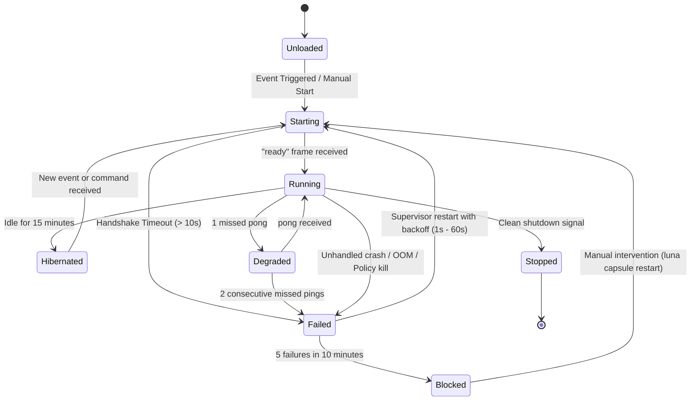

# Luna System Architecture

Luna is a self-hosted, local-first streaming platform and Twitch bot that unifies chat, platform events, VR avatar parameters and heart rate readings onto a single in-process event bus. All extensions run inside isolated execution environments called **Luna Capsules**.

This document details the core architecture, data paths, subsystem interactions, and internal mechanics of Luna.

---

## 1. High-Level System Topology

Luna operates as a single static Go binary (`CGO_ENABLED=0`) designed for local execution on Linux and Windows. Outside entities (Twitch, VRChat) connect through specialized internal adapters that translate external protocols into typed internal events.



---

## 2. Core Components

### 2.1 The Event Bus (`internal/bus`)

The event bus is an in-process publish/subscribe engine optimized for low latency and bounded memory consumption:

- **Lock-Free Ring Buffer**: Subscriptions receive events through buffered Go channels (`chan event.Event`). The default buffer holds up to 4,096 entries for durability logging and 256 for live streaming subscribers.
- **Independent Cursors**: Readers advance at their own speed. A slow plugin or blocked client does not stall publishing goroutines or other subscribers.
- **Selective Filtering**: Subscriptions can specify event type patterns (such as `twitch.*`, `twitch.chat.message`, or `hr.update`). Events not matching a subscriber's interest are filtered out in the core and never cross socket boundaries.
- **Zero-Allocation Hot Path**: Event envelopes are decoded once upon arrival from Twitch or OSC and marshaled into shared typed byte buffers.

#### Event Envelope Specification

All events traveling across the bus adhere to the unified envelope structure:

```json
{
  "id": "01J9X4N8B0K12M...",
  "type": "twitch.channel.subscribe",
  "source": "twitch",
  "ts": 1728565331000,
  "simulated": false,
  "data": {
    "user": {
      "id": "12345678",
      "login": "winterpaw",
      "roles": ["sub"]
    },
    "tier": "1000",
    "is_gift": false
  }
}
```

- `id`: Unique event identifier (monotonic timestamp-ordered Crockford Base32 identifier).
- `type`: Dot-delimited hierarchical event namespace (`twitch.*`, `osc.*`, `hr.*`, `bot.*`, `plugin.<id>.*`).
- `source`: Identifier of the originating adapter (`twitch`, `osc`, `hr`, `sim`).
- `ts`: Event timestamp in milliseconds since Unix epoch.
- `simulated`: Boolean flag. When `true`, outbound actions triggered by this event (such as chat responses or moderation bans) are routed to stdout/CLI instead of external live APIs.
- `data`: Arbitrary JSON payload specific to the event type.

---

### 2.2 Output Guard (`internal/guard`)

All outbound communications directed to Twitch chat, whispers, announcements, and moderation APIs MUST pass through the centralized Output Guard. This guarantees that security rules, spam filters, and platform rate limits are universally enforced, even if an individual plugin misbehaves.



#### Defensive Sanitization Rules
1. **Command Injection Prevention**: If an outgoing chat message begins with `/` or `.`, the guard prepends a Unicode zero-width space (`\u200B`). This prevents malicious chat inputs echoed by plugins from being interpreted as native Twitch IRC/slash commands (e.g. `/ban`, `/mod`, `/commercial`).
2. **Control Character Stripping**: All ASCII and Unicode control characters are replaced with whitespace.
3. **Length Truncation**: Messages are hard-truncated at 500 runes (the Twitch message character limit).
4. **Token Bucket Rate Limiter**: Configurable via `chat.rate_limit` (default: 20 messages per 30 seconds). Bursts wait for available tokens up to the context deadline rather than immediately dropping.
5. **Headroom Inspection**: Exposes real-time token headroom to the CLI `luna status` display.

---

### 2.3 SQLite Storage Engine (`internal/store`)

Luna uses embedded SQLite compiled via the pure-Go driver (`modernc.org/sqlite`), eliminating any dependency on `cgo` or external database daemons.

#### Storage Architecture
- **WAL Mode (`journal_mode(WAL)`)**: Concurrent readers can execute queries without blocking the single writer.
- **Synchronous Normal (`synchronous=NORMAL`)**: Provides an optimal trade-off between disk flush durability and write throughput.
- **Single Dedicated Writer**: Database connections maintain a single writer connection (`db.SetMaxOpenConns(1)`) to avoid database lock contention.
- **Batch Insertion**: Events are written in batches of up to 500 events or every 250 milliseconds, minimizing disk I/O during chat raids.

#### Database Tables
| Table | Schema Purpose |
| --- | --- |
| `events` | Append-only event log used for stream recording, auditing, and offline replay (`luna events replay`). |
| `ranks` | Durable store of granted user ranks (`luna-mod`, `head-mod`, etc.) and the principal who assigned them. |
| `capsules` | Installed capsule registry: manifest hash, version, enabled status, declared permissions, and user approval signatures. |
| `plugin_store` | Key-value store private to each capsule, supporting TTL expiration and atomic batch writes. |
| `viewers` | Shared viewer tracking profiles: first seen, last seen, message counts, watch time (in ms), streaks, and attended stream count. |

---

### 2.4 Twitch Integration (`internal/twitch`)

Luna's Twitch client uses modern Twitch APIs exclusively, avoiding legacy IRC:

1. **EventSub over WebSocket (`wss://eventsub.wss.twitch.tv/ws`)**:
   - Long-lived persistent WebSocket connection receiving real-time channel events.
   - Handles keepalive timeouts and reconnect URLs transparently without missing events.
   - Two separate connections are supported: one for the Broadcaster account (channel events) and an optional second connection for a dedicated Bot account (chat reading and chatting).
2. **Helix REST API**:
   - Pooled HTTP/2 client with persistent keep-alive.
   - Performs chat dispatch, channel updates (stream title, category), clip creation, stream markers, ad snoozing, and moderation actions.
   - Token validation executes periodically in the background with automatic token refresh before expiration.

---

### 2.5 VRChat OSC Engine (`internal/osc`)

Luna natively integrates with VRChat and OSC-compatible virtual reality platforms:

- **Reused UDP Socket**: Sends to port 9000 (VRChat OSC input) and receives on port 9001 (VRChat OSC output) by default.
- **Coalesced Parameter Updates**: Outgoing parameters are buffered and dispatched in 30 Hz frames (`time.Second / 30`). If a parameter changes multiple times within a 33 ms window, only the latest state is transmitted.
- **Chatbox Mirroring with Rate-Limiting**: Chatbox messages are spaced with a minimum 2-second gap to comply with VRChat's internal message cooldown and prevent text drops. Text is truncated at 144 characters.
- **Automatic Avatar Introspection**: Luna automatically locates the user's VRChat OSC JSON configuration files:
  - Linux: Steam Proton path (`~/.steam/steam/steamapps/compatdata/438100/pfx/.../VRChat/OSC`).
  - Windows: `%LOCALAPPDATA%/../LocalLow/VRChat/VRChat/OSC`.
  - When an avatar is worn, Luna reads its parameter definitions and validates them against configured channel point redeems.

---

### 2.6 Secrets Engine (`internal/secrets`)

Authentication tokens and integration credentials never touch plugin sandboxes or configuration files:

- **OS Keyring Integration**: Evaluates system credential stores via `go-keyring`:
  - Linux: FreeDesktop Secret Service via D-Bus.
  - Windows: Windows Credential Manager.
- **Encrypted File Fallback**: If the OS keyring is unavailable (such as in headless servers or minimal systemd user sessions), tokens are encrypted using **AES-256-GCM** with a per-user master key file stored at `0600` permissions.

---

## 3. Sandboxing & Supervision (`internal/capsule`)

Every plugin in Luna runs inside an isolated OS process called a **Luna Capsule**. The daemon acts as the supervisor, communicating with capsules over dedicated Unix domain sockets.



### Socket Triad Architecture
Each capsule is provided with three isolated Unix domain sockets:
1. `CAPSULE_CONTROL`: Handshake, lifecycle transitions (`ready`, `shutdown`), periodic health pings, and structured log streaming. Framed via CBOR messages with a 4-byte big-endian length prefix.
2. `CAPSULE_HOST`: The gRPC plugin API socket (mounted inside the capsule at `/run/bot/plugin.sock`). Provides access to `ChatSend`, `Mod`, `Twitch`, `Viewer`, `Store`, `Osc`, `Hr`, and `Timers`.
3. `CAPSULE_LINKS`: Directory containing sockets for inter-capsule communication mediated by the Luna Broker. Direct connections between capsule processes are strictly forbidden.

---

## 4. Lifecycle & Supervision State Machine



- **Exponential Backoff**: Failure restarts back off from 1 second doubling up to 60 seconds. The backoff counter resets after 10 consecutive minutes of healthy operation.
- **Hard Failure Threshold**: A capsule failing 5 times within a 10-minute window enters the `Blocked` (or terminal `Failed`) state and requires manual recovery via `luna capsule restart <name>`.
- **Durable Store**: Capsule restarts do not delete the capsule's private database entries in `plugin_store` or its allocated `data/` folder.
