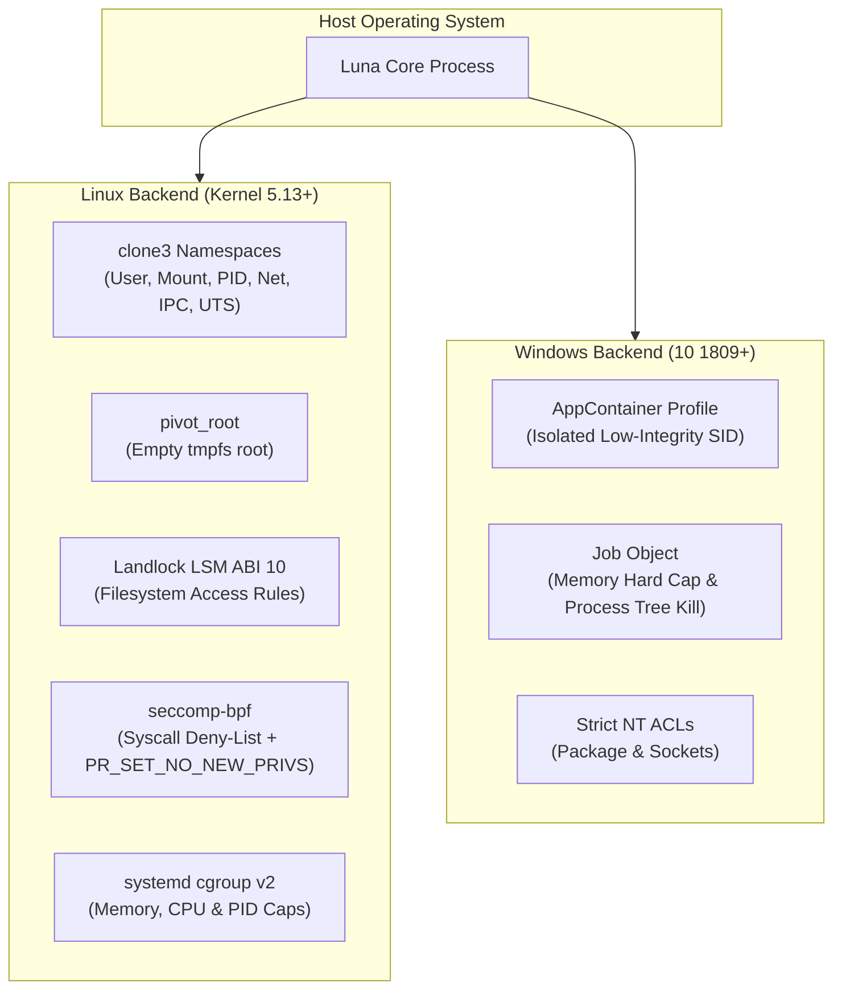
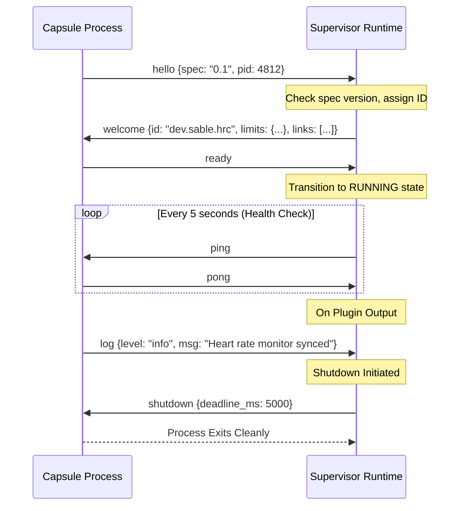

# Luna Capsules Specification & Runtime

A **Luna Capsule** is an isolated execution environment that runs untrusted third-party or first-party code as an ordinary OS process under the host's native kernel isolation primitives.

Unlike Docker or Podman, Luna Capsules require **no container images**, **no background container daemon**, and **no virtualization overhead**. They start in milliseconds, share read-only runtimes to conserve memory, and enforce strict hardware, filesystem, and network limits directly at the operating system level.

---

## 1. Package Architecture

A capsule package is either an uncompressed directory or an archive containing a directory with the `.capsule` file extension. The runtime extracts archives to a local content-addressed store (`$XDG_DATA_HOME/luna/capsules/store/<sha256>`) before execution.

```
my-plugin/
├── capsule.toml        # Capsule definition & sandbox parameters (required)
├── plugin.toml         # Luna-specific plugin metadata, permissions & commands
├── capsule.lock        # Cryptographic SHA-256 hashes of every file in the package
├── capsule.sig         # Reserved for a signature over capsule.lock; not checked yet
├── main.py             # Entrypoint script (or binary / index.ts)
└── assets/             # Read-only assets accessible to the plugin
```

> [!NOTE]
> For convenience in Luna plugins, `capsule.toml` and `plugin.toml` can be merged into a single `plugin.toml` file containing a `[capsule]` configuration table. The core runtime parses only the `[capsule]` table.

### 1.1 `capsule.toml` Manifest Schema

| Key | Type | Default | Description |
| --- | --- | --- | --- |
| `spec` | string | `"0.1"` | Capsule specification version. |
| `id` | string | **Required** | Reverse-DNS unique identifier (`[a-z0-9.-]`, max 128 chars). |
| `version` | string | **Required** | Semantic versioning string (e.g. `"1.2.0"`). |
| `runtime` | string | **Required** | Target runtime environment: `native`, `luna` (first-party plugins built into the luna binary), `python-3.12`, or `node-22`. |
| `entry` | string | **Required** | Path to the entrypoint within the package, or binary name for `native`. |
| `args` | list of string | `[]` | Additional command-line arguments passed to the entrypoint. |
| `env` | map of string | `{}` | Static environment variables. Host secrets are never passed in environment variables. |
| `limits.memory` | size string | `"64m"` | Hard physical memory ceiling enforced by the kernel (e.g. `"32m"`, `"128m"`). |
| `limits.cpu` | float | `0.25` | Fraction of a single CPU core allocated to the capsule (0.1 to 1.0). |
| `limits.pids` | int | `32` | Maximum concurrent threads/processes allowed in the capsule tree. |
| `limits.files` | int | `256` | Maximum concurrent open file descriptors. |
| `fs.writable` | string | `"data"` | Writable filesystem access: `"none"` or `"data"` (private persistent folder). |
| `fs.data_quota` | size string | `"32m"` | Maximum storage size permitted in the persistent `data/` folder. |
| `net` | string / list | `"none"` | Outbound allowlist of `host:port` (`*.example.com:443` covers subdomains), served by Luna's egress proxy; plugins use `bot.http` (HTTPS only). |
| `devices` | list of string | `[]` | Hardware access classes. Not built yet: packages that set it are refused. |
| `links.provides` | list of string | `[]` | Exported RPC link endpoints offered to other capsules. |
| `links.uses` | list of string | `[]` | Imported RPC links consumed from other capsules. |
| `health.interval` | duration | `"5s"` | Heartbeat check interval. |
| `health.timeout` | duration | `"2s"` | Maximum allowable response time for a health check ping. |
| `restart` | string | `"always"` | Restart behavior: `"always"`, `"on-failure"`, or `"never"`. |

---

## 2. Shared Runtimes

Memory efficiency is achieved through **Shared Runtimes**. Rather than bundling a complete Python or Node.js environment into every plugin package, Luna maintains single, canonical runtime installations located at `$XDG_DATA_HOME/luna/runtimes/`:

```
runtimes/
├── python-3.12/
│   ├── bin/python3
│   ├── lib/python3.12/...
│   └── runtime.toml
└── node-22/
    ├── bin/node
    └── runtime.toml
```

### Runtime Resolution and Isolation
- **Read-Only Mounting**: The shared runtime directory is mounted or mapped read-only into every capsule process tree. The operating system shares identical code pages in physical RAM across multiple running plugins.
- **Strict Isolation**: Sandboxes are denied access to system Python (`/usr/bin/python3`, `/usr/lib/python3`) and host global packages. Only the shared runtime tree and the plugin package folder are visible.
- **Embedded SDKs**: The Luna Go binary embeds the core Python and TypeScript SDK packages (`sdk/python/embed.go` and `sdk/node/embed.go`). When bootstrapping a capsule, the runtime exposes the SDK directly at `/sdk`, removing the need for `pip install` or `npm install` for standard bot capabilities.

| Runtime | Execution Mechanism | Overhead (RSS) |
| --- | --- | --- |
| `native` | Direct static binary execution | $\le 3\text{ MB}$ |
| `luna` | The luna binary itself, its pages shared with the daemon | about 3.5 MB |
| `python-3.12` | Isolated CPython running with `-I -S` (Linux only so far) | $\le 20\text{ MB}$ |
| `node-22` | Node.js 22 running `.ts` directly (Linux only so far) | about 33 MB |

---

## 3. Platform Isolation Backends

Luna provides native kernel sandboxing on Linux and Windows. macOS has no backend yet.



### 3.1 Linux Backend
1. **Unprivileged Namespaces**: Processes are launched via `clone3` inside isolated user, mount, PID, network, IPC, and UTS namespaces. Unprivileged user namespaces eliminate the need for `root` or `sudo`.
2. **Filesystem Isolation (`pivot_root`)**: The process pivots into an empty `tmpfs`. The package directory and shared runtime are bind-mounted read-only (`MS_RDONLY | MS_NODEV | MS_NOSUID`). A private persistent `data/` folder is mounted read-write. A minimal `/dev` (`null`, `zero`, `urandom`) and a fresh `/proc` are created.
3. **Landlock LSM**: Landlock (ABI 10) enforces a second non-bypassable filesystem security layer. Even if a process were to escape a mount namespace, the kernel denies reads outside the package and denied writes outside `data/`.
4. **seccomp-bpf**: Enforces `PR_SET_NO_NEW_PRIVS` and blocks dangerous system calls: `ptrace`, `mount`, `bpf`, `perf_event_open`, `keyctl`, `kexec_file_load`, `init_module`, and nested user namespace creation.
5. **Cgroups v2**: When running under a systemd user session (`systemd-run`), memory and PID limits are enforced via cgroups. On systems without systemd delegation, Luna falls back to `setrlimit` and an active supervisor RSS watchdog.
6. **Network Namespace**: The capsule network namespace contains only a loopback interface. Hosts listed in `net` are reached through the egress proxy on `$CAPSULE_EGRESS`; nothing else, and never a private address.

### 3.2 Windows Backend (10 1809+)
1. **AppContainer Isolation**: Each package is assigned a dedicated, low-integrity AppContainer security profile and SID with no default capabilities. Access to user documents, system files, and the registry is blocked.
2. **Job Objects**: Limits physical memory, CPU percentage, and active child process counts. Configured with `JOB_OBJECT_LIMIT_KILL_ON_JOB_CLOSE` so terminating the supervisor immediately terminates all child processes.
3. **No Network & Sockets**: The AppContainer has no network capability, so the capsule can't reach the internet or loopback. Communication with Luna occurs through `AF_UNIX` sockets whose folder is granted to the capsule's SID by an NT Access Control List (ACL).
4. **Untested so far**: the Windows backend is cross-compiled and vetted; its conformance tests (`internal/capsule/sandbox/windows_test.go`) haven't run on Windows yet.

---

## 4. Control Channel & Socket Triad

Plugins never communicate with the outside world directly. Upon launch, the supervisor provides three Unix domain sockets passed via environment variables:

| Socket | Variable | Target Peer | Protocol | Purpose |
| --- | --- | --- | --- | --- |
| **Control** | `CAPSULE_CONTROL` | Supervisor Runtime | Length-Prefixed CBOR | Lifecycle, heartbeats, logs |
| **Host API** | `CAPSULE_HOST` | Luna Core Daemon | gRPC over Unix Socket | Bot API, Twitch, Store, OSC |
| **Links** | `CAPSULE_LINKS` | Runtime Link Broker | Length-Prefixed CBOR | Inter-capsule RPC calls |

### 4.1 Wire Framing Protocol
Messages on the Control and Links channels use a standard frame:
- **Length**: 4-byte big-endian integer specifying the payload size.
- **Payload**: CBOR-encoded map with structure:
  ```json
  {
    "t": "message_type",
    "id": 1001,
    "b": { ... }
  }
  ```
- **Size Limit**: Frames larger than 1 MiB (1,048,576 bytes) are rejected, and the socket connection is immediately closed.

### 4.2 Control Messages



---

## 5. Brokered Inter-Capsule Links

Direct inter-process communication between capsules is blocked. Capsules collaborate through **Brokered Typed Links**.

```mermaid
flowchart LR
    subgraph CapsuleB["Consumer Capsule (luna.giveaways)"]
        BClient["bot.links.use('luna.points')"]
    end

    subgraph Broker["Luna Link Broker (Core)"]
        BrokerEngine["Security Validation\n• Check declared permissions\n• Enforce rate limit (50/s)\n• Stamp Caller ID: 'luna.giveaways'\n• Enforce 64 KiB message cap"]
    end

    subgraph CapsuleA["Provider Capsule (luna.points)"]
        AServer["bot.links.provide('spend')"]
    end

    BClient -->|call {id, method, body}| BrokerEngine
    BrokerEngine -->|call with caller_id| AServer
    AServer -->|result {id, ok, body}| BrokerEngine
    BrokerEngine -->|result| BClient
```

### Link Guarantees
1. **Declared Permissions**: A link is opened only when Provider `A` declares `provides = ["spend"]`, Consumer `B` declares `uses = ["luna.points:spend"]`, and the user approved the link during installation.
2. **Caller ID Verification**: The broker stamps every request frame with the verified caller ID (`luna.giveaways`). The receiving plugin cannot be spoofed by other local processes.
3. **Resilience & Graceful Degradation**: If Provider `A` crashes or restarts, Consumer `B` immediately receives a `link_down` signal, and subsequent calls fail instantly with `LinkUnavailable` rather than hanging indefinitely.

---

## 6. Supervision, Health & Failure Recovery

The supervisor monitors child processes and records precise failure reasons upon termination:

| Failure Cause | Detection Mechanism |
| --- | --- |
| `exit` | Process terminated with a non-zero exit code. |
| `crash` | Terminated by unhandled fatal signal (`SIGSEGV`, `SIGABRT`) or unhandled panic. |
| `oom` | Kernel OOM killer triggered or physical RSS memory threshold exceeded. |
| `unhealthy` | Two consecutive `ping` heartbeats failed to receive a `pong` within 2 seconds. |
| `handshake` | Failed to transmit valid `hello` frame within 10 seconds of process startup. |
| `policy` | Process terminated due to seccomp violation, Job Object restriction, or namespace denial. |

### Diagnostic Ring Buffer
For each capsule, the supervisor maintains a **1 MiB in-memory ring buffer** capturing:
- Structured `log` frames sent via the control socket.
- Standard output (`stdout`).
- Standard error (`stderr`).

When a capsule fails or exits unexpectedly, the last 200 log lines are preserved in the permanent failure record and can be inspected via:
```sh
luna capsule logs <name>
```

---

## 7. Conformance Verification

To confirm that a host environment complies with the Luna Capsules security model, the test suite executes an automated matrix of attack vectors against the sandbox:

```sh
luna capsule doctor
```

```
✓ user namespaces    filesystem, process, network and IPC isolation
✓ landlock           ABI 10, second filesystem layer
✓ seccomp            syscall deny list
✓ cgroup limits      hard memory, CPU and process caps via systemd scopes
✓ network allowlists  only the hosts a capsule lists, through Luna's egress proxy; no private addresses
✗ data quota         per-file size cap only, not a total quota
```

Automated unit tests in `internal/capsule/...` verify:
- Probing `~/.ssh` or `/etc/shadow` from inside the sandbox returns `EACCES` / `ENOENT`.
- Attempting to establish external TCP/UDP connections with `net = "none"` fails immediately.
- Fork-bombing beyond `limits.pids` is blocked by the kernel.
- Allocations exceeding `limits.memory` are halted by the OOM watchdog.
- Child processes cannot see or signal the host daemon process tree.
