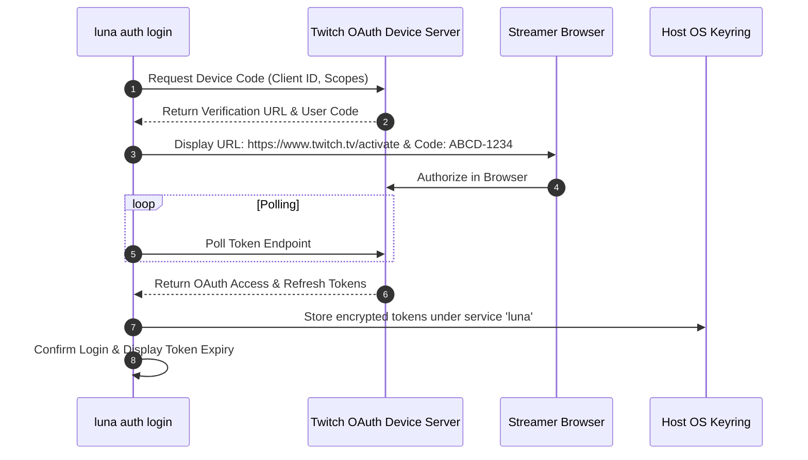

# Luna CLI Reference Manual

The `luna` executable is a dual-purpose binary: it runs the core background daemon (`luna daemon`) and serves as the command-line control client for managing all aspects of the bot, stream events, integrations, and capsules.

When executing management commands, `luna` communicates with the active daemon over a protected local Unix domain socket (`$XDG_RUNTIME_DIR/luna/control.sock` or `~/.local/share/luna/luna.sock`).

---

## 1. Syntax, Grammar & Global Flags

```
luna [--config <dir>] <command> [subcommand] [arguments...] [flags...]
```

Luna uses a **noun-before-verb** grammar (e.g. `luna capsule install`, `luna auth login`). Top-level shortcuts exist for frequently accessed operational views (`luna status`, `luna logs`).

### Global Flags

| Flag | Description |
| --- | --- |
| `--config <dir>` | Specifies a custom configuration directory. Data files are placed in `<dir>/data`, isolating tokens and state for multi-channel setups. |

`--json` (on a plugin's commands, `luna events tail` and `luna chat tail`) prints JSON instead of a table, and `--yes` on `luna capsule install` skips the prompt when the same permissions were approved before.

### Exit Codes

| Exit Code | Name | Meaning |
| :---: | --- | --- |
| `0` | `SUCCESS` | Command completed successfully. |
| `1` | `FAILURE` | General runtime error or execution failure. |
| `2` | `USAGE` | Invalid arguments, syntax error, or interactive prompt required in non-interactive shell. |
| `3` | `DAEMON_OFFLINE` | Daemon is not running or control socket is unreachable. |
| `4` | `CAPSULE_OFFLINE`| The plugin whose command you ran isn't running. |

---

## 2. Daemon & Process Management

### `luna daemon` (or `luna run`)
Runs the Luna core daemon in the foreground. This process initializes the event bus, SQLite storage, Twitch connections, output guard, and capsule runtime.
```sh
luna daemon
```

### `luna start` / `luna stop` / `luna restart`
Controls the installed systemd user service (`luna.service`) on Linux or Scheduled Task on Windows.
```sh
luna start      # Start systemd user unit
luna stop       # Stop the running service
luna restart    # Restart the background service
```

### `luna status`
Displays real-time daemon status, uptime, integration states, chat rate-limit headroom, and capsule health.
```sh
luna status
```
*Output preview:*
```
daemon    up 4h 12m 30s
twitch    connected as BroadcasterName, chatting as BotAccount
chat      19 messages available before the rate limit
capsules  6 running; not running: none
osc       VRChat heard 4s ago; avatar Winterpaw, 42 parameters
```

### `luna reload`
Instructs the running daemon to re-read `luna.toml` and apply changes without dropping the Twitch connection or restarting unaffected capsules.
```sh
luna reload
```

### `luna logs`
Streams or displays the circular in-memory log buffer from the daemon or an individual capsule.
```sh
luna logs                     # View last 100 log lines from the daemon
luna logs -f                  # Follow live daemon logs
luna logs --capsule luna.hrc  # View logs for a specific capsule
```

### `luna version`
Prints the exact binary version, Git commit hash, supported Plugin API version, and Capsule specification version.
```sh
luna version
```

---


### Dashboard (`luna tui`)
A full-screen dashboard in the terminal: daemon and Twitch status; the capsules (click one to see its log, then Restart, Enable or Disable); tabs for live events, the moderation timeline (select an entry, then Undo) and the daemon log; and a box to chat as Luna. Mouse and keyboard both work: `1`/`2`/`3` switch tabs, Tab moves between panes, Esc leaves the chat box, `q` quits. It talks to the daemon like the CLI does and reconnects by itself if the daemon restarts.

## 3. Interactive Setup Wizard (`luna setup`)

The interactive setup wizard guides initial deployment from zero to a live stream setup. Steps can be run sequentially or executed individually.

```sh
luna setup [step] [--no-service]
```

### Setup Steps
| Step | Command | Description |
| --- | --- | --- |
| `check` | `luna setup check` | Verifies host kernel capabilities, user namespaces, Landlock, and seccomp via `capsule doctor`. |
| `twitch`| `luna setup twitch`| Initiates OAuth Device Code flow for the Broadcaster channel account. |
| `bot` | `luna setup bot` | Optional OAuth Device Code flow for a separate chat bot account. |
| `runtime`| `luna setup runtime`| Downloads or links the shared Python 3.12 / Node.js runtime. |
| `integrations`| `luna setup integrations`| Turns on VRChat OSC with its default ports. |
| `service`| `luna setup service`| Installs and enables the `systemd` user service unit (`~/.config/systemd/user/luna.service`). |
| `core` | `luna setup core` | Installs the default first-party core bundle (`luna.core`). |
| `smoke` | `luna setup smoke` | Fires a simulated follow event and verifies that chat/output pipelines respond. |

---

## 4. Twitch Authentication (`luna auth`)

Manages Twitch OAuth tokens stored in the secure OS keyring.



### Commands
- `luna auth login [broadcaster|bot]`: Starts device-code login for the specified account role.
- `luna auth login spotify`: Logs in to Spotify for song requests (needs `[spotify] client_id`, from an app at developer.spotify.com with redirect URI `http://127.0.0.1:43219/callback`). Luna listens on that address only until the browser comes back.
- `luna auth login deepl`: Saves a DeepL API key for chat translation (typed without showing on screen, checked before saving).
- `luna auth status`: Displays logged-in accounts, Twitch User IDs, active token scopes, and expiration timestamps.
- `luna auth logout [broadcaster|bot]`: Revokes OAuth tokens with Twitch API and deletes them from local secure storage.
- `luna auth scopes add <scope>`: Requests authorization for an additional Twitch OAuth scope.

---

## 5. Configuration Management (`luna config`)

Safely inspects and modifies `luna.toml`. All changes are validated against configuration schemas before committing to disk.

```sh
luna config show [key]              # Print effective config (tokens and secrets masked)
luna config get <key>               # Retrieve a single setting (e.g. luna config get chat.rate_limit)
luna config set <key> <value>       # Update a setting (e.g. luna config set chat.rate_limit 25)
luna config edit                    # Opens luna.toml in $EDITOR; validates upon saving
luna config validate                # Tests current syntax and schema without applying
```

---

## 6. Stream Simulation & Event Tools

Stream tools enable offline testing of alerts, redemptions, chat triggers, and plugins without needing a live stream.

### 6.1 Event Simulator (`luna sim`)
Fires artificial events into the internal event bus. Simulated events are marked `simulated: true`, ensuring outbound chat is directed to the console rather than live Twitch chat unless explicitly forced.

```sh
luna sim --list                     # List all available simulation event triggers
luna sim follow [--user <name>]     # Simulate a channel follow
luna sim sub [--user <name>] [--tier 1|2|3]  # Simulate a subscription
luna sim cheer [--user <name>] [--bits <n>]  # Simulate a bits cheer
luna sim raid [--user <name>] [--viewers <n>]# Simulate an incoming raid
luna sim redeem <reward> [input]    # Simulate a channel point redemption
luna sim resub [--user <name>] [--months <n>]# Simulate a resubscription
luna sim gift [--user <name>] [--count <n>]  # Simulate a gift sub bomb
luna sim online                     # Simulate stream going live
luna sim offline                    # Simulate stream going offline
luna sim hr <bpm>                   # Simulate biometric heart rate reading
luna sim avatar <id> [name]         # Simulate wearing a new VRChat avatar
luna sim param <name> <value>       # Simulate an avatar OSC parameter change
```

### 6.2 Stream Tailing & Replay
- `luna events tail [--type <pattern>] [--json]`: Streams bus events in real time. Filterable by type (e.g. `--type twitch.*`).
- `luna chat tail`: Observes raw chat activity directly in the terminal.
- `luna events sessions`: Lists historical stream sessions recorded in SQLite.
- `luna events replay <session-id> [--speed <n>]`: Replays a recorded stream's exact event sequence through the event bus with scaled time pacing (e.g. `--speed 4`).

### 6.3 Chat & Moderation Tools
- `luna chat say <text>`: Dispatches a message to chat as the bot, passing through the output guard.
- `luna mod timeline [--since 1h]`: Displays a reverse chronological timeline of all timeouts, bans, message deletions, and bot actions.
- `luna mod undo <action-id>`: Reverses an earlier moderation action (e.g. unbans a user, cancels a timeout, restores a counter).

---

## 7. Integrations CLI (`luna osc` & `luna integrations`)

### VRChat OSC Tools
- `luna osc send <address> <value>`: Manually dispatches an OSC parameter to VRChat for testing (e.g. `luna osc send /avatar/parameters/Ears true`).
- `luna osc params`: Inspects the currently active VRChat avatar and lists its exposed parameters, types, and read/write capabilities.
- `luna integrations list`: Shows the OSC connection state and where heart rate comes from.
- `luna integrations test osc`: Sends a test message to the VRChat chatbox; check it shows in game.

---

## 8. Permissions & Ranks (`luna perms`)

Manages the 5-tier rank ladder (`viewer`, `moderator`, `luna-mod`, `head-mod`, `broadcaster`).

```sh
luna perms show [<user>]            # Display ranks and assigned capabilities
luna perms set <user> <rank>        # Assign user rank (e.g. luna perms set alex luna-mod)
luna perms check <user> <capability># Check if a user possesses a specific capability
```

---

## 9. Capsule Lifecycle Management (`luna capsule`)

Controls packaging, sandboxing, installation, and inspection of Luna Capsules.

```sh
# Installing and Removing
luna capsule install [--yes] <folder|archive|name> # Install plugin package
luna capsule uninstall <name> [--keep-data]         # Uninstall capsule

# Runtime Control
luna capsule list                   # List installed capsules, version, and status
luna capsule enable <name>          # Enable an installed capsule
luna capsule disable <name>         # Stop and disable a capsule
luna capsule restart <name>         # Restart a running or failed capsule
luna capsule logs <name> [-f]       # View or follow a capsule's ring buffer logs
luna capsule inspect <name>         # View limits, granted permissions, and failure history

# Packaging and Development
luna capsule doctor                 # Verify OS sandbox security capabilities
luna capsule init <name> [--runtime python-3.12|node-22] # Scaffold a new plugin project
luna capsule dev [dir] [--live]     # Regenerate plugin.toml from the code and run the plugin against the simulator
luna capsule pack [dir] [-o file]   # Compile package, compute capsule.lock, and create archive
luna capsule verify <path>          # Verify a package's file hashes against its capsule.lock
luna capsule runtime add <name>     # Install or link a shared language runtime

# The plugin index ([index] in luna.toml)
luna capsule search [term]          # Plugins in the signed index
luna capsule install <id or name>   # Download, check against the signed index, then install as usual
luna capsule update [name]          # Newer versions from the index; disables revoked ones

# Maintaining an index
luna index keygen <keyfile>                                   # New signing key (keep it offline)
luna index sign <dir> --key <keyfile>                         # Sign index.json for every .capsule in dir
luna index revoke <dir> --key <keyfile> <id> <version|*> <reason>
```

---

## 10. Plugin Dynamic Command Groups

When a capsule declares custom commands in its manifest under `[cli]`, Luna automatically maps them as first-class subcommands under `luna <alias>`:

```sh
# Core Bundle
luna core commands                  # List custom chat commands
luna core quotes                    # List recorded quotes
luna core counters                  # List counters and current values
luna core phrase-add <pattern>      # Add banned regex phrase
luna core phrase-remove <pattern>   # Remove banned regex phrase

# Points Plugin
luna points top [--n 10]            # Display points leaderboard
luna points get <user>              # Query user points balance
luna points add <user> <amount>     # Manually adjust points

# Giveaways Plugin
luna giveaways status               # View active giveaway state and entrants
luna giveaways verify               # Cryptographically verify fairness of previous draw
luna giveaways export               # Export entry list and commit hash

# Stream Tools Plugin
luna stream title <text>            # Update stream title
luna stream game <name>             # Update game category (with fuzzy matching)
luna stream recap                   # Display stream statistics recap

# Heart Rate Plugin
luna hrc summary                    # Show stream heart rate stats (peak, resting)
luna hrc now                        # Show current BPM reading
```
