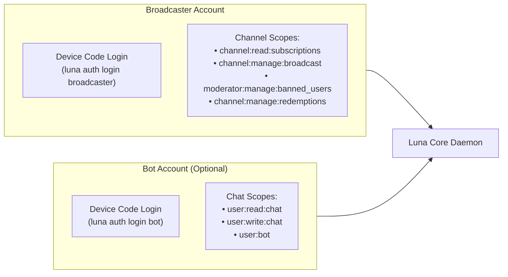
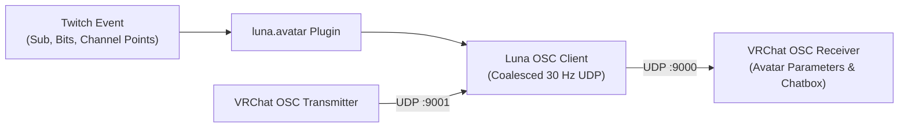
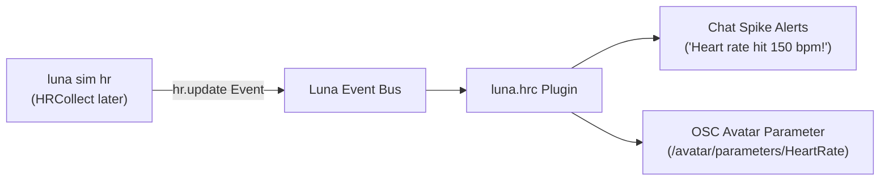

# Hardware, VR & Platform Integrations

Luna connects Twitch, VRChat avatars and heart rate readings onto a unified event bus.

This guide covers setting up Twitch, VRChat OSC and the heart rate plugin.

---

## 1. Twitch Platform Setup

Luna utilizes Twitch's modern EventSub WebSocket and Helix REST APIs. No public webhook URL, reverse proxy, or open router port is required.



### 1.1 Authentication Workflow
1. Run the interactive authenticator for your channel account:
   ```sh
   luna auth login broadcaster
   ```
2. The CLI will output a verification URL (`https://www.twitch.tv/activate`) and a unique 8-character device code:
   ```
   Open https://www.twitch.tv/activate and enter code: ABCD-1234
   ```
3. Open the URL in your web browser, verify the scopes, and click **Authorize**.
4. *(Optional but Recommended)* Authenticate a separate secondary account for the bot:
   ```sh
   luna auth login bot
   ```
   > [!TIP]
   > When a dedicated bot account is authenticated, chat messages are read and posted under the bot account's identity. Channel administrative operations (moderation bans, stream title updates, ad breaks) are dispatched under the broadcaster's identity.

### 1.2 Inspecting Authentication Status
```sh
luna auth status
```
Outputs active accounts, Twitch User IDs, authorized scopes, and token expiration countdowns.

---

## 2. VRChat & OSC Avatar Integration

Luna natively speaks Open Sound Control (OSC) over UDP to interact with VRChat.



### 2.1 Enabling OSC in VRChat
1. Launch VRChat and open your in-game **Action Menu** (radial menu).
2. Navigate to **Options** $\rightarrow$ **OSC**.
3. Toggle **Enabled** to **ON**.

### 2.2 Enabling OSC in Luna
Edit `luna.toml` to activate the OSC integration:
```toml
[osc]
enabled = true
send    = "127.0.0.1:9000"  # Target VRChat input port
listen  = "127.0.0.1:9001"  # Target VRChat output port
```
Apply the changes and restart or reload:
```sh
luna restart
```

### 2.3 Inspecting Active Avatar Parameters
Luna automatically scans for VRChat's local avatar configuration JSON files:
- **Linux (Steam Proton)**: `~/.steam/steam/steamapps/compatdata/438100/pfx/drive_c/users/steamuser/AppData/LocalLow/VRChat/VRChat/OSC/`
- **Windows**: `%LOCALAPPDATA%\..\LocalLow\VRChat\VRChat\OSC\`

When you change avatars in VRChat, Luna reads its parameter configuration. To inspect the current avatar's parameters and types from the terminal:
```sh
luna osc params
```

### 2.4 Mapping Channel Points & Bits to Avatar Toggles
In `luna.toml`, add parameter mappings under `[plugins.avatar]`:
```toml
# Toggle parameter (flips boolean state)
[[plugins.avatar.redeem]]
reward = "Toggle Ears"
param  = "Ears"
action = "toggle"

# Pulse parameter (turns on, waits duration, then turns off)
[[plugins.avatar.redeem]]
reward   = "Sparkle Burst"
param    = "Sparkles"
action   = "pulse"
duration = "5s"

# Set parameter (assigns integer or float value)
[[plugins.avatar.bits]]
min    = 500
param  = "Outfit"
action = "set"
value  = 2
```

### 2.5 Testing OSC Manually
Test an avatar parameter directly from the terminal without spending channel points:
```sh
luna osc send /avatar/parameters/Ears true
luna osc send /avatar/parameters/Outfit 2
```

---

## 3. Heart Rate

The heart rate plugin reacts to `hr.update` events. Today they come from `luna sim hr <bpm>`; HRCollect, a separate project, will send real readings once it can serve them.



### 3.1 Enabling the Heart Rate Plugin
Install the heart rate capsule:
```sh
luna capsule install hrc
```

Configure alert thresholds in `luna.toml`:
```toml
[plugins.hrc]
name             = "Winterpaw"
alert            = true
alert_bpm        = 140
alert_message    = "{name}'s heart rate just spiked to {bpm} bpm! 💓"
alert_cooldown_s = 300
osc_param        = "HeartRate" # Sends the BPM as is; "" to not send it
```

### 3.2 Chat Commands
- `!hr`: The current BPM reading (`luna hrc summary` has resting, average and peak).
- `!hr off` / `!hr on`: The broadcaster hides or shows the heart rate, in chat and on the avatar.

### 3.3 Simulating Heart Rate Offline
You can simulate biometric readings to test thresholds and alerts without wearing a physical monitor:
```sh
luna sim hr 155
```

---

## 4. System Service Deployment

Luna is designed to run continuously in the background as an unprivileged user service.

### 4.1 Linux: Systemd User Service
During initial setup, `luna setup service` installs a user-level systemd unit:
`~/.config/systemd/user/luna.service`:

```ini
[Unit]
Description=Luna, a self-hosted Twitch bot
Documentation=luna --help

[Service]
ExecStart=/path/to/luna daemon
Restart=on-failure
RestartSec=5

[Install]
WantedBy=default.target
```

#### Managing the Service
```sh
luna start    # or: systemctl --user enable --now luna.service

# View background status and live logs
systemctl --user status luna
journalctl --user -u luna -f
```

> [!TIP]
> To allow the Luna daemon to keep running on a headless homelab machine after logging out of an SSH session, enable user lingering:
> ```sh
> loginctl enable-linger $USER
> ```

### 4.2 Windows
There's no Windows service yet: run `luna daemon` from your session.
