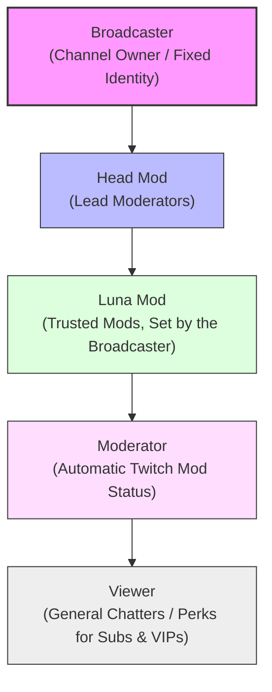
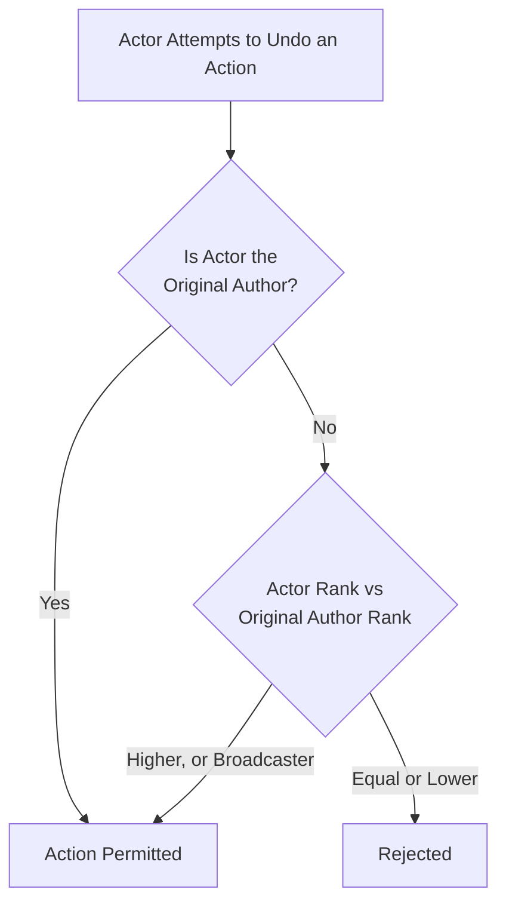

# Permissions, Ranks & Governance

Luna implements a multi-tier governance model designed to solve trust and permission challenges in live streaming. Unlike standard bots that treat all channel moderators as a single flat role, Luna introduces a **5-tier rank ladder**, a timeline of who did what, and override rules.

---

## 1. The 5-Tier Rank Ladder

### Rank Definitions

| Rank | Identity Source | How Granted | Default Capabilities |
| --- | --- | --- | --- |
| **Broadcaster** | Setup Account | Fixed upon initial `luna setup`. | Unrestricted authority: install capsules, grant capabilities, manage security, access secrets. Cannot be demoted or overridden. |
| **Head Mod** | Twitch Badge / Manual | Automatic upon `lead_moderator` chat badge detection, or set via `luna perms set <user> head-mod`. | Configure chat filters and commands, run giveaways, override all lower ranks. |
| **Luna Mod** | Manual | A Twitch mod the broadcaster promotes with `luna perms set <user> luna-mod`. | Timeline undo across plain moderators, run giveaways, adjust points, edit the title and category. |
| **Moderator** | Automatic Twitch Role | Inherited from Twitch channel moderator status. | Standard chat moderation (`!timeout`, `!ban`, `!permit`, `!nuke`), custom command management, undo their own actions. |
| **Viewer** | Everyone | Default rank for all channel visitors. | Basic chat interaction, viewer commands (`!points`, `!enter`, `!join`, `!hr`). |

### Perks vs. Permissions
Subscribers and VIPs are viewers with **perks**, not administrative permissions:
- Perks include extra giveaway luck and exemptions from message filters (`mod_exempt`).
- Perks **never** unlock moderation commands, CLI access, or state mutations.

---

## 2. Override Rules

Every moderation action and counter change in the core bundle's timeline records the actor's login and rank at the time. Points keeps its own ledger the same way.

### The Rules
1. **Higher Rank Overrides Lower Rank**: A Luna Mod can undo a Moderator's timeout. A Head Mod can undo a Luna Mod's. The Broadcaster can undo anyone's.
2. **No Same-Rank Overrides**: Moderators can't undo each other's actions (no mod wars), and neither can two Luna Mods or two Head Mods.
3. **Self-Reversal**: Anyone can undo their own action, and Luna's automatic actions can be undone by any moderator.

Undo with `!undo <id>` in chat or `luna mod undo <id>`; `luna mod timeline` lists the ids.

### Automatic Demotion
If the broadcaster removes someone's moderator badge on Twitch, Luna sees the `channel.moderator.remove` event and drops their Luna rank to viewer.

---

## 3. Capability Matrix

Ranks represent bundles of granular **capabilities**:

| Capability | Viewer | Moderator | Luna Mod | Head Mod | Broadcaster |
| --- | :---: | :---: | :---: | :---: | :---: |
| `chat.commands.use` | ✓ | ✓ | ✓ | ✓ | ✓ |
| `mod.delete`, `mod.timeout`, `mod.warn` | | ✓ | ✓ | ✓ | ✓ |
| `mod.ban` | | ✓ | ✓ | ✓ | ✓ |
| `mod.undo.own` | | ✓ | ✓ | ✓ | ✓ |
| `mod.undo.others` | | | ✓ | ✓ | ✓ |
| `commands.edit` | | ✓ | ✓ | ✓ | ✓ |
| `filters.edit` | | | ✓ | ✓ | ✓ |
| `giveaway.run` | | | ✓ | ✓ | ✓ |
| `points.adjust` | | | ✓ | ✓ | ✓ |
| `stream.edit` (title, category, ads) | | | ✓ | ✓ | ✓ |
| `perms.grant`, `capsule.install`, `auth.*` | | | | | **Broadcaster Only** |

### Broadcaster-Only Capabilities
`capsule.install`, `perms.grant`, `auth.*` and `config.security` belong to the broadcaster alone: they're actions taken at the machine (`luna capsule install`, `luna auth login`, editing `luna.toml`), never from chat, and no rank below broadcaster can be given them.

Each chat command needs one capability, and Luna checks it before the plugin sees the command. See who can do what with `luna perms show` and `luna perms check <user> <capability>`.
