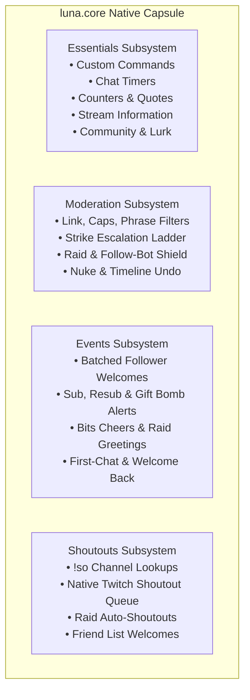
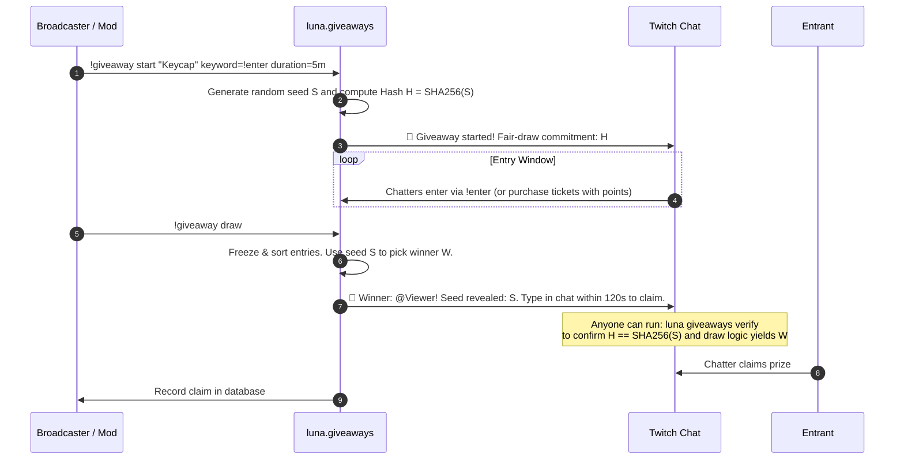

# Luna Plugins Catalog & Reference

Luna ships with a comprehensive suite of first-party plugins designed to handle every facet of live streaming—from community chat management and automated moderation to provably fair giveaways, VRChat OSC avatar integration, and real-time biometric telemetry.

---

## 1. Plugin Catalog Overview

| Plugin | Package ID | CLI Alias | Install Command | Included in Core | Highlights |
| --- | --- | --- | --- | :---: | --- |
| **Core Bundle** | `luna.core` | `core` | `luna setup` | **Yes** | Essentials, Moderation, Events, Shoutouts |
| **Points** | `luna.points` | `points` | `luna capsule install points` | No | Loyalty currency, watch time streaks, leaderboards |
| **Giveaways** | `luna.giveaways` | `giveaways` | `luna capsule install giveaways` | No | Provably fair draws with cryptographic seed verification |
| **Stream Tools**| `luna.stream` | `stream` | `luna capsule install stream` | No | Title/game updates, clips, VOD markers, ad alerts, recaps |
| **Avatar** | `luna.avatar` | `avatar` | `luna capsule install avatar` | No | VRChat OSC parameter redeems, chatbox mirror |
| **Heart Rate** | `luna.hrc` | `hrc` | `luna capsule install hrc` | No | `!hr`, spike alerts, avatar sync |
| **Games** | `luna.games` | `games` | `luna capsule install games` | No | Duels, heists and trivia with Points |
| **Polls** | `luna.polls` | `polls` | `luna capsule install polls` | No | Twitch polls and predictions, chat polls without them |
| **Queue** | `luna.queue` | `queue` | `luna capsule install queue` | No | Viewer queues with sub priority and whispered invites |
| **Song Requests**| `luna.songs` | `songs` | `luna capsule install songs` | No | Spotify requests with limits, blocklist, playlist allowlist, points or redeem cost |
| **Accessibility**| `luna.access` | `access` | `luna capsule install access` | No | Pronouns (pronouns.alejo.io), chat translation with DeepL |

---

## 2. The Core Bundle (`luna.core`)

The Core Bundle ships as a single compiled native Go capsule (`__bundle`) hosting four integrated subsystems: **Essentials**, **Moderation**, **Events**, and **Shoutouts**. Running as a unified native capsule satisfies Luna's performance budget by using less than 10 MB of RAM while maintaining strict sandboxing from the core daemon.



---

### 2.1 Essentials Subsystem

The everyday toolkit for streamers, moderators, and viewers.

#### Custom Commands (`!cmd`)
- Add, update, and manage dynamic chat commands directly from chat or CLI.
- **Syntax**: `!cmd add !discord Join our community: {link.discord}`
- **Permissions**: Requires capability `commands.edit` (default: Moderator and above).
- **Command Variables**:
  - `{user}`: Name of the chatter invoking the command.
  - `{target}`: First argument passed after the command name (or defaults to caller).
  - `{count}`: Number of times this command has been invoked.
  - `{uptime}`: Current elapsed stream duration (e.g. `2h 15m`).
  - `{game}`: Current streaming category.
  - `{title}`: Current stream title.
  - `{followage}`: Duration the caller has followed the channel.
  - `{random min-max}`: Random integer between `min` and `max`.
  - `{pick a|b|c}`: Randomly selects one of the pipe-delimited choices.
- **Dispatch Modes**: Can reply via normal chat message, threaded reply, native announcement (`/announce`), or whisper (`/w`).

#### Chat Timers (`!timer`)
- Automated recurring messages that post at fixed intervals.
- **Chat Activity Guard**: Timers only trigger while the stream is live and at least `timer_min_messages` (default: 5) have occurred in chat since the previous timer.
- **Message Rotation**: Timers accept multiple messages and cycle through them in round-robin sequence so chat never sees the same text twice in a row.

#### Counters (`!counter`)
- Numerical counters with optional per-game tracking:
  - `!counter add deaths pergame` (mods; drop `pergame` for one count across every game)
  - `!deaths` $\rightarrow$ "Deaths in Elden Ring: 9"
  - `!deaths +` / `!deaths -` (mods) $\rightarrow$ Counts up or down for the current game; undoable from the timeline.
  - `!deaths set 15` (mods) $\rightarrow$ Explicit override.

#### Quotes (`!quote`)
- Records memorable quotes stamped with the game, date, and user who added it.
- `!quote add "I definitely know what I'm doing."` $\rightarrow$ "Added quote #42."
- `!quote` $\rightarrow$ Retrieves a random quote.
- `!quote 42` $\rightarrow$ Retrieves quote #42.
- `!quote search jump` $\rightarrow$ Searches quotes containing the term.

#### Stream Info & Community
- **Stream Info**: `!uptime`, `!game`, `!title`, `!followage [user]`, `!accountage`, `!watchtime`.
- **Lurk Support**: `!lurk` and `!unlurk` calculate the user's elapsed away time.
- **Birthdays**: Viewers register their birthday (`!birthday 03-14`); Luna posts an automated greeting the first time they chat on that day.
- **Viewer Notes**: Moderators attach private notes to users (`!note <user> <text>`), visible via `!mod history <user>`.

---

### 2.2 Moderation Subsystem

Automated protection designed to neutralize spam and raids without disrupting regular chat conversations. Every moderation action is recorded in the timeline with reverse capability.

#### Multi-Layer Message Filters
| Filter | Default | Logic & Behavior |
| --- | :---: | --- |
| **Links** | Enabled | Detects URLs and bare domains across standard TLDs. Exempts permitted users (`!permit <user> [s]`) and domains listed in `mod_link_allow`. |
| **Banned Phrases**| Enabled | Matches RE2 regular expressions against a confusables-folded string (defeating l33tspeak, Cyrillic lookalikes, and zero-width characters). |
| **Excessive Caps** | Enabled | Flags messages longer than 15 characters containing over 70% uppercase letters. |
| **Symbols & Zalgo**| Enabled | Flags combining-character floods and repetitive non-alphanumeric symbol patterns. |
| **Repeat Spam** | Enabled | Detects identical or character-collapsed messages repeated within a short window. |
| **Emote Floods** | Disabled | Triggers when emote count exceeds `mod_emotes_max` (default: 10). |
| **Message Length** | Disabled | Enforces maximum character lengths (`mod_long_max`). |

#### Strike Ladder & Escalation
Violations trigger progressive disciplinary actions defined by `mod_ladder`:
```
delete -> 60s timeout -> 10m timeout -> flag for mod review
```
- Strikes decay automatically after `mod_strike_decay_m` (default: 60 minutes) of clean behavior.
- Utilizes native Twitch `/warn` dialogs when enabled (`mod_warn_native = true`), requiring the chatter to acknowledge the warning before chatting again.

#### Raid & Follow-Bot Shield
- Automatically detects mass bot attacks:
  - Spike of new followers within 30 seconds (`mod_shield_follows`).
  - Coordinated burst of identical first-chat messages (`mod_shield_same_text`).
- Instantly activates Twitch Shield Mode, followers-only mode, or slow mode, and notifies channel moderators.
- Automatically deactivates after `mod_shield_off_m` (default: 10 minutes) or via `!shield off`.

#### Moderator Commands
- `!permit <user> [seconds]`: Grants a chatter permission to post one link within 60 seconds.
- `!nuke <phrase> [seconds]`: Bulk-times-out every chatter who typed the matching phrase in the last 60 seconds.
- `!nuke undo`: Instantly reverses all timeouts issued by the last nuke.
- `!mod history <user>`: Displays strikes, previous timeouts, account age, and mod notes.
- `!undo`: Reverses the actor's most recent moderation action.

---

### 2.3 Events Subsystem

Intelligent, templated thank-you messages for platform milestones.

- **Batched Follower Welcomes**: Follows arriving in bursts are batched within a 10-second window:
  > *"Welcome Ana, Ben, Cy and 4 others to the pack!"*
- **Collapsed Gift Sub Bombs**: Individual gifted subscriptions trigger a single thank-you message acknowledging the gifter and total count, preventing 50 individual chat alerts.
- **Supported Alerts**:
  - `follow`, `sub`, `resub` (including total months).
  - `gift` (gift sub bombs).
  - `bits` (cheers with bit count).
  - `raid` (incoming raids with viewer count).
  - `first` (first-ever message from a new chatter).
  - `welcome_back` (regular chatter returning after 14+ days away).

---

### 2.4 Shoutouts Subsystem

- `!so <user>`: Fetches the target channel's latest stream category, posts a formatted promotional link in chat, and automatically queues a native Twitch `/shoutout`.
- **Intelligent Cooldown Queue**: Twitch imposes a 2-minute global cooldown and a 1-hour per-channel cooldown on native shoutouts. Luna queues requested shoutouts and drains them sequentially as platform timers expire.
- **Raid Auto-Shoutout**: Automatically issues shoutouts to channels raiding your stream.
- **Friends Auto-Shoutout**: Issues an automatic shoutout to streamer friends listed in `so_friends` the first time they chat during a broadcast.

---

## 3. Points Plugin (`luna.points`)

`luna.points` is a lightweight, local loyalty currency engine.

```sh
luna capsule install points
```

### Features & Accrual Rules
- **Watch Time Accrual**: Chatters earn points (e.g. 10 points every 5 minutes) only while the stream is live and they have chatted recently (`active_window_m = 10`), preventing idle bot farming.
- **Bonus Multipliers**: Points awarded for following, subscribing, gifting, bits, and raids.
- **Stream Attendance Streaks**: Consecutive streams attended are tracked. Milestones (5, 10, 25 streams) trigger automated shoutouts.
- **Commands**:
  - `!points`: Checks balance and current stream streak.
  - `!top`: Displays the channel leaderboard.
  - `!give <user> <amount>`: Transfers points between chatters.
  - `!points add/remove <user> <amount>`: Mod command for balance adjustments.
- **Audit Ledger & Undo**: Every manual modification or transfer is logged in the ledger and can be reversed:
  ```sh
  luna points ledger
  luna points undo <id>
  ```

---

## 4. Giveaways Plugin (`luna.giveaways`)

`luna.giveaways` provides provably fair giveaways where chatters can independently verify that the draw was not manipulated.

```sh
luna capsule install giveaways
```

### 4.1 Cryptographic Fair-Draw Workflow



### 4.2 Configuration & Entry Rules
- **Eligibility Filters**: Minimum follow duration (e.g. 7 days), minimum account age, exclude moderators/broadcaster, exclude winners from the past $N$ days.
- **Weighted Luck**: Subscribers and VIPs receive extra ticket weights, capped by `luck_cap` to preserve fairness.
- **Ticket Purchasing**: Integrated with `luna.points` via brokered RPC links (`luna.points:spend`).
- **Claim Timer**: Winners must chat within `claim_s` (default: 120 seconds) or mods can trigger `!giveaway reroll`.

---

## 5. Stream Tools (`luna.stream`)

Operational utilities to streamline broadcasts.

```sh
luna capsule install stream
```

- **Title & Category Updates**: `!title <text>` and `!game <name>`. Includes fuzzy category matching; if an exact category isn't matched, Luna suggests the closest Twitch categories.
- **Clips & Markers**:
  - `!clip`: Generates a high-resolution clip via Twitch API and posts the link in chat.
  - `!marker <description>`: Drops an editorial timestamp marker on the VOD for video editors.
- **Ad Break Alerts**:
  - Warns chat 60 seconds before a scheduled ad break (`ad_warn_s = 60`).
  - `!ads snooze` snoozes pending mid-roll ad breaks when an intense in-game moment occurs.
  - Automatically posts a thank-you message after the ad finishes.
- **Schedule**: `!schedule` queries the broadcaster's Twitch schedule and displays upcoming streams converted to the viewer's local timezone.
- **Stream Recap**: When the stream goes offline, Luna generates an operational recap:
  ```sh
  luna stream recap
  ```
  *Summarizes: New followers, subscriber count, peak viewers, top chatters, clips generated, markers dropped, and total counter increments.*

---

## 6. Avatar OSC Integration (`luna.avatar`)

Connects Twitch events directly to VRChat avatar parameters over OSC.

```sh
luna capsule install avatar
```

### Configuration Mappings (`luna.toml`)
No code required. Mappings link Twitch Channel Point rewards and Bits to avatar OSC parameters:

```toml
[[plugins.avatar.redeem]]
reward = "Toggle Ears"
param = "Ears"
action = "toggle"

[[plugins.avatar.redeem]]
reward = "Sparkle Burst"
param = "Sparkles"
action = "pulse"
duration = "5s"

[[plugins.avatar.bits]]
min = 500
param = "Outfit"
action = "set"
value = 3
```

### Features
- **Parameter Validation**: Automatically scans local VRChat OSC JSON config files to verify parameter names and types. Typos and missing parameters are surfaced via `luna avatar params`.
- **Chatbox Mirroring**: Mirrors Twitch chat into the in-game VRChat chatbox. Configurable modes: `off`, `subs`, `highlighted`, or explicit redeems (`say`). Enforces VRChat's 2-second rate limit and 144-character truncation.
- **Avatar Swap Awareness**: Detects avatar changes dynamically, ensuring parameter updates are never sent to an avatar that does not support them.

---

## 7. Heart Rate Telemetry (`luna.hrc`)

Turns `hr.update` heart rate events (from `luna sim hr` today, from HRCollect once it can serve readings) into chat and VRChat avatar effects.

```sh
luna capsule install hrc
```

- **Chat Commands**: `!hr` shows the current heart rate. The broadcaster can hide it at any time with `!hr off` (and `!hr on`).
- **Spike Alerts**: Posts in chat when the streamer's BPM crosses a threshold (off by default):
  ```toml
  [plugins.hrc]
  alert = true
  alert_bpm = 140
  alert_message = "Streamer's heart rate spiked to {bpm} bpm! 💓"
  alert_cooldown_s = 300
  osc_param = "HeartRate"
  ```
- **Avatar OSC Sync**: Sends the live BPM to `/avatar/parameters/HeartRate`, allowing avatar shaders and animations to beat in sync with your real pulse.
- **Summary Metrics**: `luna hrc summary` shows the stream's resting BPM, average BPM, peak, and how far into the stream it peaked.
