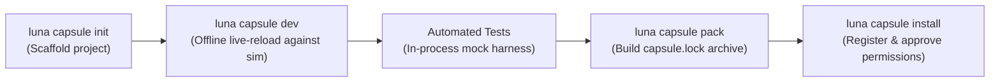

# Luna Plugin Development & SDK Reference

Luna plugins are isolated extensions running inside Luna Capsules that interact with the core engine through the **Luna Plugin API** (v1).

The Luna SDK provides first-class support for **Python**, **TypeScript / Node.js**, and **Go**, presenting an identical, idiomatic API surface across all three ecosystems. A smaller **Rust** SDK covers events, chat and CLI commands, the store, moderation, Twitch calls, OSC, heart rate and links (no `http`, Spotify, translation or test harness yet).

---

## 1. Quick Start: The 5-Line Plugin

Creating a plugin requires no boilerplate classes or manual networking code.

### 1.1 Python
```python
from luna import bot

@bot.on("twitch.channel.follow")
def on_follow(ev):
    bot.chat.send(f"Welcome to the pack, {ev.user.name}!")

bot.run()
```

### 1.2 TypeScript
```ts
import { bot } from "@luna/sdk";

bot.on("twitch.channel.follow", (ev) => {
  bot.chat.send(`Welcome to the pack, ${ev.user.name}!`);
});

bot.run();
```

### 1.3 Go
```go
package main

import "luna/sdk/go"

func main() {
    b := luna.New()
    b.On("twitch.channel.follow", func(ctx *luna.Ctx, ev *luna.Event) error {
        return b.Chat.Send(ctx, "Welcome to the pack, "+ev.User().Name+"!")
    })
    b.Run()
}
```

### 1.4 Rust
```rust
fn main() {
    let mut bot = luna::Bot::new();
    bot.on("twitch.channel.follow", |ctx, ev| async move {
        ctx.chat().send(format!("Welcome to the pack, {}!", ev.user().unwrap_or_default().name)).await
    });
    bot.run();
}
```

Go and Rust plugins are `native` capsules: a static binary at `bin/linux-amd64/<entry>` in the
plugin folder, with `runtime = "native"` in `plugin.toml`. For Rust, depend on the SDK with
`luna-sdk = { path = "<luna>/sdk/rust" }` and build it static:

```sh
RUSTFLAGS="-C target-feature=+crt-static" cargo build --release --target x86_64-unknown-linux-gnu
cp target/x86_64-unknown-linux-gnu/release/<name> capsule/bin/linux-amd64/
luna capsule dev capsule/    # keep plugin.toml and bin/ in their own folder: pack takes the whole folder
```

`sdk/rust/examples/live.rs` is a complete plugin (config, store, events, a CLI command, a link).

---

## 2. Plugin Development Lifecycle



1. **Scaffold**: `luna capsule init my-plugin --runtime python-3.12` creates starter code, tests, and a manifest.
2. **Develop**: `luna capsule dev` starts the plugin against an embedded event simulator. File changes trigger instant restarts. Outbound chat is printed to stdout rather than dispatched to live Twitch channels.
3. **Test**: Run unit tests offline using the in-process SDK test harness.
4. **Pack**: `luna capsule pack` calculates SHA-256 hashes, writes `capsule.lock`, and bundles files into a `.capsule` archive.
5. **Install**: `luna capsule install ./my-plugin` prompts for user approval of permissions and activates the capsule.

---

## 3. Manifest Definition (`plugin.toml`)

The `plugin.toml` manifest declares the capsule configuration, permissions, exposed commands, and configuration schema:

```toml
id = "dev.sable.hrc"
name = "Heart Rate Alerts"
version = "0.1.0"
api = "1"

[capsule]
runtime = "python-3.12"
entry = "main.py"
limits = { memory = "64m", cpu = 0.25 }
net = "none"

[permissions]
events = ["hr.update", "twitch.chat.message"]
chat = ["send"]
osc = ["send:/avatar/parameters/Panic"]
store = true

[links]
provides = ["spike"]
uses = ["dev.sable.overlay:show"]

[cli]
name = "hrc"

[[cli.commands]]
name = "threshold"
summary = "Inspect or adjust alert threshold"
args = [{ name = "bpm", type = "int", optional = true }]
flags = [{ name = "reset", type = "bool" }]
mutates = true

[[chat.commands]]
name = "hr"
aliases = ["heartrate"]
capability = "chat.commands.use"
cooldown = { global = "10s", user = "30s" }

[config]
threshold = { type = "int", default = 140 }
```

> [!TIP]
> When developing in Python or TypeScript, `luna capsule dev` automatically inspects function signatures and decorators, writing `[cli.commands]` and `[chat.commands]` into `plugin.toml` automatically.

---

## 4. Events & Subscriptions

### 4.1 Subscribing to Events
Handlers register using `bot.on(type, ...)` and receive typed event structures:

```python
# Exact event type match
@bot.on("twitch.channel.follow")
def on_follow(ev):
    bot.log.info(f"Follower: {ev.user.name}")

# Filter in the decorator to avoid boilerplate
@bot.on("twitch.channel.redeem", reward="Hydrate")
def on_hydrate(ev):
    bot.chat.send(f"Taking a sip! Thanks {ev.user.name} 💧")

# Wildcard pattern with predicate
@bot.on("twitch.*", when=lambda ev: ev.user and ev.user.is_mod)
def log_mod_action(ev):
    bot.log.info(f"Mod activity from {ev.user.name}: {ev.type}")

# Fire once, then unsubscribe
@bot.once("bot.start")
def on_startup(ev):
    bot.chat.send("Luna is online.")
```

### 4.2 Awaiting Events Inline (`wait_for`)
Handlers can asynchronously pause execution until a matching event arrives:

```python
@bot.chat_command("duel")
async def duel(ctx, target: str):
    await ctx.reply(f"{target}, type !accept within 30s to accept the duel!")
    
    # Wait up to 30 seconds for target's response
    msg = await bot.wait_for(
        "twitch.chat.message",
        user=target,
        text="!accept",
        timeout=30.0
    )
    if msg:
        await ctx.reply(f"Duel accepted! May the best chat warrior win!")
    else:
        await ctx.reply(f"{target} backed down.")
```

---

## 5. Chat & CLI Commands

### 5.1 Chat Commands (`@bot.chat_command`)
Chat commands are invoked by chatters using prefixes like `!hr`. Luna validates rank capabilities, cooldowns, and spam checks in the core daemon before forwarding the command to the capsule:

```python
@bot.chat_command(
    name="hr",
    aliases=["heartrate"],
    capability="chat.commands.use",
    cooldown="5s",
    user_cooldown="20s"
)
def hr_command(ctx):
    # ctx.reply automatically addresses the caller
    ctx.reply(f"Current Heart Rate: {bot.hr.bpm} bpm")
```

#### Context Object Attributes
- `ctx.reply(text)`: Dispatches a threaded reply directly addressing the triggering chat message.
- `ctx.user`: Object detailing `id`, `login`, `name`, `roles` (`["sub", "vip", "mod"]`), and `rank` (`"viewer"`, `"luna-mod"`, etc.).
- `ctx.user.can(capability)`: Evaluates whether the user's rank grants a capability.
- `ctx.args`: List of raw string arguments passed to the command.

### 5.2 CLI Commands (`@bot.cli`)
Plugins expose terminal commands accessible via `luna <plugin> <command>`. Argument schemas and type conversions are derived directly from the function signature:

```python
@bot.cli("threshold", mutates=True)
def threshold_cli(bpm: int | None = None, reset: bool = False):
    """Inspect or update the heart rate threshold alert."""
    if reset:
        bot.store.delete("threshold")
    elif bpm is not None:
        bot.store.set("threshold", bpm)
        
    current = bot.store.get("threshold", default=bot.config.threshold)
    # Returning a dictionary or list renders an automatic formatted terminal table
    # or formatted JSON when invoked with --json
    return {"threshold_bpm": current, "is_default": current == bot.config.threshold}
```

---

## 6. Durable State (`bot.store`)

Plugins store private state inside Luna's SQLite database via `bot.store`. State persists across plugin restarts, crashes, and updates:

```python
# Basic Key-Value operations
bot.store.set("stream_deaths", 12)
deaths = bot.store.get("stream_deaths", default=0)
bot.store.delete("stream_deaths")

# Atomic increment
new_total = bot.store.incr("viewer_points:user123", by=50)

# Automatic TTL expiration (in seconds)
bot.store.set("command_lockout", True, ttl=60)

# Prefix queries
all_counters = bot.store.keys(prefix="counter:")

# Atomic write batch / transaction
with bot.store.transaction():
    bot.store.set("user:1:tickets", 5)
    bot.store.incr("total_pot", 500)
```

---

## 7. Shared Viewer Profiles (`bot.viewers`)

Luna maintains a global database of channel viewers, tracking attendance, watch time, and chat frequency:

```python
viewer = bot.viewers.get("winterpaw")
if viewer:
    print(f"First Seen: {viewer.first_seen}")
    print(f"Watch Streak: {viewer.streak} consecutive streams")
    print(f"Total Watch Time: {viewer.watch_s / 3600:.1f} hours")
```

---

## 8. Inter-Capsule Links (`bot.links`)

Capsules communicate across sandboxes through typed RPC links brokered by Luna:

### Provider Capsule (`dev.sable.overlay`)
```python
# Manifest: provides = ["show"]
@bot.links.provide("show")
def show_overlay_alert(text: str, duration: int = 5) -> bool:
    bot.log.info(f"Rendering overlay alert: {text} for {duration}s")
    # Update the overlay here
    return True
```

### Consumer Capsule (`dev.sable.hrc`)
```python
# Manifest: uses = ["dev.sable.overlay:show"]
overlay = bot.links.use("dev.sable.overlay", "show")

@bot.on("hr.update", when=lambda ev: ev.bpm > 150)
def on_heart_spike(ev):
    try:
        # Transparent remote procedure call
        overlay.show(text=f"HEART RATE SPIKE: {ev.bpm} BPM!", duration=8)
    except bot.LinkUnavailable:
        bot.log.warn("Overlay plugin is offline or restarting; alert skipped.")
```

---

## 9. Hardware & Platform Integrations

### 9.1 VRChat OSC (`bot.osc`)
```python
# Read cached parameter from VRChat
is_ears_up = bot.osc.param("Ears")

# Send parameter update (coalesced at 30 Hz)
bot.osc.send("/avatar/parameters/Panic", True)

# Mirror text to the in-game chatbox (rate-limited at 2s interval)
bot.osc.chatbox(f"New sub from {ev.user.name}!")
```

### 9.2 Biometrics & Heart Rate (`bot.hr`)
```python
# Instantaneous BPM reading
current_bpm = bot.hr.bpm

# Query historical BPM series (up to 60 minutes)
recent_samples = bot.hr.history(minutes=15)
for sample in recent_samples:
    print(f"{sample.at}: {sample.bpm} bpm")
```

---

### 9.3 Internet Access (`bot.http`)
Plugins have no network of their own. List the hosts a plugin needs in `plugin.toml`, and the streamer approves them at install:
```toml
[capsule]
net = ["api.example.com:443", "*.cdn.example.com:443"]
```
Then reach them over HTTPS through Luna's egress proxy:
```python
r = bot.http.get("https://api.example.com/v1/thing", headers={"authorization": "Bearer ..."})
if r.status == 200:
    data = r.json()
```
TypeScript: `await bot.http.get(url, { headers })`, `bot.http.post(url, { json })`. Go: `bot.HTTP` is a standard `*http.Client`. In tests, `t.http.mock("api.example.com", json={...})` fakes a host.

---

## 10. Timers & Schedulers (`bot.timers`)

Timers are scheduled by the Luna core daemon rather than internal process threads, guaranteeing that timers survive capsule reloads:

```python
# Single delayed action
bot.timers.after("30s", lambda: bot.osc.send("/avatar/parameters/Alert", False))

# Recurring interval (optionally restricted to when chat is active)
@bot.timers.every("15m", only_if_chat_active=True)
def hydration_reminder():
    bot.chat.send("Time for a hydration check! 💧")

# Cron expression (evaluated against host system timezone)
@bot.timers.cron("0 20 * * FRI")
def weekend_stream_announcement():
    bot.chat.send("Happy Friday stream! 🎉")
```

---

## 11. Typed Configuration (`bot.use_config`)

Plugins declare typed configuration classes that Luna validates against `luna.toml`:

```python
from luna import Config

class PluginSettings(Config):
    threshold: int = 140
    alert_template: str = "{name}'s heart rate hit {bpm} bpm!"
    enable_osc: bool = True

bot.use_config(PluginSettings)

# Strongly-typed access with IDE autocomplete
if bot.config.enable_osc and bot.hr.bpm > bot.config.threshold:
    bot.chat.send(bot.config.alert_template.format(name="Streamer", bpm=bot.hr.bpm))
```

---

## 12. In-Process Testing Harness

The SDK includes a testing harness (`luna.testing.harness`) that executes plugins in-process against an artificial Luna core. Tests run without a running daemon, without sandboxes, and without live Twitch credentials.

### Example Unit Test (Python `unittest`)

```python
import unittest
from luna.testing import harness
import main  # Imports your plugin entrypoint

class HeartRatePluginTest(unittest.TestCase):
    def setUp(self):
        # Initialize test harness with custom config overrides
        self.t = harness(main, config={"threshold": 140})

    def test_spike_alert_triggers_chat_and_cooldown(self):
        # 1. Emit simulated biometric event
        self.t.emit("hr.update", bpm=150)
        
        # 2. Verify chat message was dispatched
        self.assertEqual(len(self.t.chat.sent), 1)
        self.assertIn("150 bpm", self.t.chat.sent[0])
        
        # 3. Subsequent event within cooldown is suppressed
        self.t.emit("hr.update", bpm=155)
        self.assertEqual(len(self.t.chat.sent), 1)

    def test_cooldown_expiration_via_time_travel(self):
        self.t.emit("hr.update", bpm=150)
        
        # Instantly advance simulated virtual clock by 5 minutes
        self.t.clock.advance("5m")
        
        self.t.emit("hr.update", bpm=152)
        self.assertEqual(len(self.t.chat.sent), 2)

    def test_cli_command(self):
        result = self.t.cli("threshold", bpm=165)
        self.assertEqual(result["threshold_bpm"], 165)
        self.assertEqual(self.t.store.get("threshold"), 165)

if __name__ == "__main__":
    unittest.main()
```

### Running Tests Across Environments
- **Python**: `python3 -m unittest` or `pytest`
- **TypeScript**: `node --import ./sdk/node/register.mjs --test`
- **Go**: `go test ./...`
- **Rust**: `go test ./sdk/rust/` runs the SDK against Luna's real plugin server; test your own plugin with `luna capsule dev`
