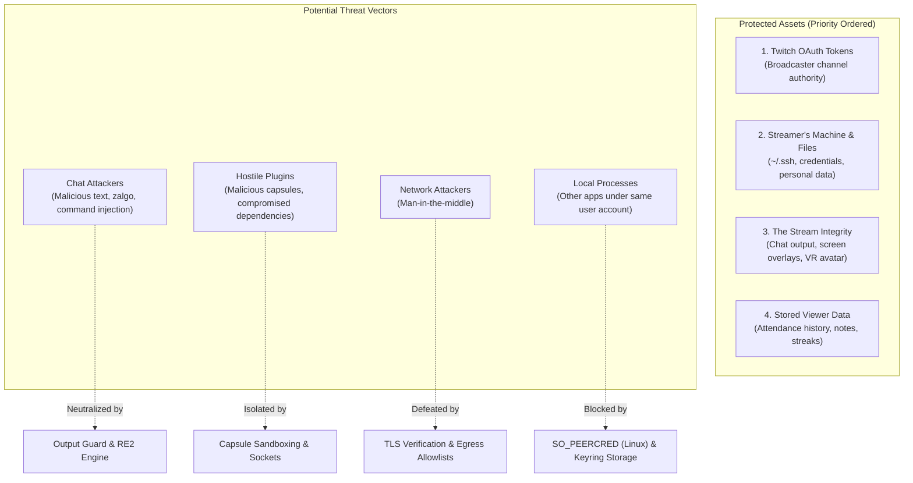
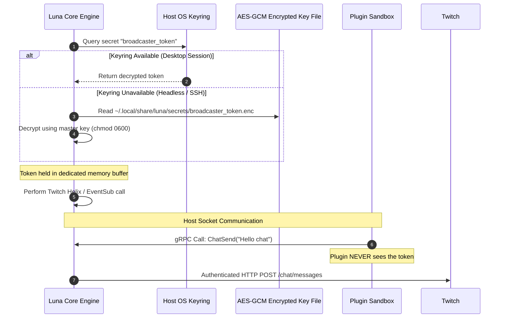

# Security Architecture & Sandboxing

Luna is built on a **defensive security model** that treats chat messages, network responses, and third-party plugins as untrusted by default. The platform eliminates common exploit primitives at the architectural level, preventing bugs or compromised plugins from escalating into machine takeovers or channel hijackings.

---

## 1. Threat Model & Protected Assets

### Threat Boundaries
- **Untrusted Chat**: Chatters can transmit arbitrary Unicode text, emojis, and control characters. Chat is strictly treated as passive data.
- **Untrusted Plugins**: Anyone can write and distribute a capsule. The runtime guarantees that a malicious capsule cannot exfiltrate credentials, read personal documents, or establish arbitrary network connections.
- **Untrusted Network**: External API connections use TLS 1.2+ with strict certificate validation.

---

## 2. Elimination of Exploit Primitives

Rather than relying on best-effort filters, Luna designs exploit building blocks out of the system:

| Exploit Primitive | Architectural Defense |
| --- | --- |
| **Memory Corruption** | Core daemon implemented in pure Go with `CGO_ENABLED=0`; `unsafe` is used only in the sandbox package (seccomp, Landlock, Windows process attributes). Native capsule crashes are isolated to their own sandboxed process. |
| **Command Injection** | Luna **never executes system shells** (`sh`, `bash`, `cmd.exe`). Subprocesses are spawned exclusively via direct `exec` syscalls using structured argument arrays. |
| **SQL Injection** | All SQLite queries take their values as parameters, never by building SQL strings from input. |
| **Path Traversal & Zip-Slip** | Package extraction validates that every path resides strictly beneath the destination target. Absolute paths, `..` traversals, and symlinks/hardlinks inside packages are rejected, and extraction writes through Go's `os.Root`, which can't leave the target folder. |
| **ReDoS (RegEx DoS)** | All regular expressions (chat filters, banned phrases, plugin triggers) are compiled and executed using Go's linear-time **RE2** engine. Exponential backtracking algorithms are impossible. |
| **Plugin Network Access & SSRF** | Capsules have no network of their own (Linux: loopback-only namespace; Windows: no network capability). The only way out is Luna's egress proxy on the capsule's socket, which allows just the `host:port` entries in `[capsule].net` (approved at install), resolves DNS itself, refuses private, loopback, link-local, CGNAT and cloud-metadata addresses, and connects to the address it checked. TLS stays end to end. |
| **Chat Command Injection** | Outgoing chat is sent via Twitch Helix REST API rather than raw IRC. Any outgoing text starting with `/` or `.` is automatically prepended with a zero-width space (`\u200B`), preventing echoed text from executing channel commands. |
| **Privilege Escalation** | Luna refuses to run as `root`. On Linux capsules run with dropped capabilities and `PR_SET_NO_NEW_PRIVS`; on Windows, in an AppContainer with no capabilities. |
| **Unicode & Bidi Spoofing** | Bidirectional control characters and zero-width spaces are stripped from command names before matching. The core bundle's moderation filters also fold lookalike letters and accents before matching banned phrases. |

---

## 3. Secrets Management & Token Isolation

Twitch OAuth tokens and integration secrets reside exclusively within the core daemon and are never accessible to plugin processes.

### Key Principles
1. **Zero Secret Exposure**: Tokens are never passed via command-line arguments, environment variables, IPC frames, or configuration files.
2. **Dual-Account Separation**:
   - The Broadcaster token is restricted to channel administrative operations (EventSub subscriptions, moderation actions, rewards).
   - A dedicated secondary Bot account token is used for chat reading and sending, limiting exposure if chat credentials were ever compromised.
3. **Keyring Priority**: Evaluates system credential managers (Secret Service, Windows Credential Manager, Apple Keychain). Fallback storage uses authenticated AES-256-GCM encryption with master keys restricted to file mode `0600`.

---

## 4. Local IPC Surface & Socket Hardening

Luna opens **no TCP listening ports**. All inter-process communication occurs over local Unix domain sockets. (With `[osc] enabled = true` it also listens for VRChat on UDP 127.0.0.1:9001.)

### Peer Credential Verification
Every connection to Luna's control socket (`luna.sock`) verifies caller identity using kernel peer credentials:
- **Linux**: `SO_PEERCRED` checks the caller's UID against the daemon owner's.
- **Other systems**: not checked yet; the socket file itself is owner-only.

On Linux, connections from another user on the machine are immediately closed, preventing multi-user local privilege escalation even if socket file permissions are misconfigured.

---

## 5. Software Supply Chain & Update Security

Luna implements verification checks to prevent supply chain tampering:

### 1. The Signed Plugin Index
- `luna capsule search`, `install <name>` and `update` read a plugin index: `index.json` plus a detached **Ed25519** signature, from the `https` URL in `[index] url`. Luna trusts only the public key in `[index] public_key`; an index that doesn't verify is refused whole.
- Each entry names its package's content hash. A downloaded package must match its entry's ID, version and hash exactly, or it isn't installed.
- **Revocation**: the signed index lists revoked versions (or every version, `*`). They can't be installed, and `luna capsule update` disables any that are.
- The maintainer signs with `luna index sign`, using a private key from `luna index keygen` kept offline.

### 2. Hash-Locked Plugin Packages
- Plugins generate a `capsule.lock` manifest recording the SHA-256 hash of every file in the package tree.
- The package unpacker verifies every hash prior to moving files into the content-addressed store (`$XDG_DATA_HOME/luna/capsules/store/<hash>`).
- Installing a version that asks for different permissions shows them and asks for approval again (`--yes` only skips the prompt for permissions approved before).

### 3. Static Builds & Dependency Hygiene
- Builds are fully static (`CGO_ENABLED=0`, `-trimpath`, `-ldflags="-s -w"`).
- All dependencies are pinned in `go.sum`. Per-package signatures (`capsule.sig`) and signed Luna updates aren't built; packages from the index are covered by the index's signature.
