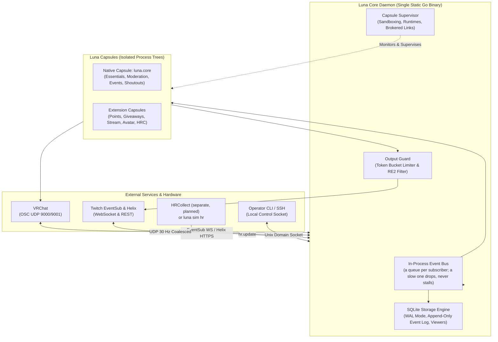

# 🌙 Luna

**A self-hosted, local-first streaming platform and Twitch bot that treats your entire stream as one unified event bus.**

Chat messages, platform alerts, VRChat avatar parameters and heart rate readings all feed into a single in-process bus—and extensions react to any of them in real time.

All extensions run in isolated OS sandboxes called **Luna Capsules** with hardware resource caps, declared permissions, and auto-restart supervision.

---

## ✨ What Sets Luna Apart

| Feature | Why Other Bots Don't Have It |
| --- | --- |
| **VRChat OSC Bridge** | Cloud bots cannot reach your local VR session. Luna connects natively to VRChat over OSC: channel point rewards flip avatar toggles, outfit shaders pulse on bits, and chat mirrors to your in-game chatbox. |
| **Biometric Telemetry (HRCollect)** | Reacts to `hr.update` heart rate events (from `luna sim hr` today, and from HRCollect, a separate project, once it can serve readings). Viewers use `!hr`, alerts trigger on horror-game spikes, and your avatar's heart beats in sync with your pulse. |
| **Unified Event Bus** | Normal bots only react to chat commands. Luna routes Twitch, OSC, heart rate and timer events across one bus, enabling composite triggers: *"When HR > 140 during a horror game and a sub arrives, trigger jumpscare."* |
| **Isolated Plugin Capsules** | No Docker, Podman, or heavy VMs required. Each plugin runs as an ordinary OS process inside native kernel isolation (Namespaces + Landlock on Linux; AppContainer + Job Objects on Windows) in Python, TypeScript, or Go. |
| **Offline Simulator & Stream Replay** | Test plugins, commands, and redemptions offline without going live. Fire fake subs, raids, and redeems with `luna sim`, or replay recorded stream sessions at $10\times$ speed with `luna events replay`. |
| **Local-First SQLite Storage** | Viewer attendance records, watch time, streaks, quotes, and counters are stored in an embedded SQLite database on your machine. You own your data, with no cloud tracking or subscription fees. |
| **Zero-Downtime Hot Reload** | Update `luna.toml` or install new capsules without restarting the bot or dropping your Twitch EventSub WebSocket connection. |
| **Timeline with One-Click Undo** | Every timeout, ban, message deletion, counter increment, and point adjustment is logged with who did it. Reverse mistakes with a single `!undo` or `luna mod undo`. |
| **5-Tier Rank Ladder & Luna Mods** | Solves the flat-moderator problem. Introduces authenticated **Luna Mods** (Twitch mods who authenticate with their own token) who can undo other mods, lock actions, and execute allowlisted CLI commands from chat. |
| **Provably Fair Giveaways** | Uses cryptographic SHA-256 seed commitments revealed after the draw. `!giveaway verify` posts the seed, and `luna giveaways export` gives the entry list, so anyone can re-run the draw and confirm the winner wasn't hand-picked. |
| **Enforced Performance Gates** | Core daemon idles under **30 MB RAM** and adds under **2 ms** of event overhead (budgets in the Performance spec; not yet checked automatically). |
| **Security by Design** | No shell invocations, linear-time RE2 regexes (no ReDoS), tokens isolated in OS keyrings, plugin network limited to approved hosts through an SSRF-blocking egress proxy, and zero-width escaping to prevent chat command injection. |

---

## 🏗️ Architecture at a Glance



---

## ⚡ Quick Start

### 1. Build from Source
Luna requires **Go 1.22+** and compiles into a single, dependency-free static binary:

```sh
git clone https://github.com/sillynickdev/Luna.git
cd Luna
make build
```
*(Optional: run `make install` to place the binary in `~/.local/bin/luna`)*.

### 2. Verify Your Machine's Sandbox
Run the sandbox diagnostics tool to verify that your operating system meets the capsule security requirements:
```sh
./luna capsule doctor
```
```
✓ user namespaces    filesystem, process, network and IPC isolation
✓ landlock           ABI 10, second filesystem layer
✓ seccomp            syscall deny list
✓ cgroup limits      hard memory, CPU and process caps via systemd scopes
```

### 3. Run the Interactive Setup Wizard
Take a fresh install to a configured, authenticated bot in minutes:
```sh
./luna setup
```
The wizard will:
1. Verify sandbox capabilities.
2. Guide you through Twitch Device OAuth login for your Broadcaster account (and optional Bot account).
3. Link your shared Python 3.12 or Node.js runtime.
4. Test the VRChat OSC connection.
5. Install and enable the `systemd` background user service (`luna.service`).
6. Install the default Core Bundle (`luna.core`).
7. Fire an automated smoke test follow event to confirm operation.

### 4. Start the Bot
If you chose not to install the systemd service, run the daemon in the foreground:
```sh
./luna daemon
```

In another terminal, inspect real-time daemon status:
```sh
./luna status
```

---

## 🧪 Stream Simulation & Offline Testing

Luna lets you test alerts, redeems, chat triggers, and plugins without streaming or touching Twitch:

```sh
# Fire simulated events into the bus
./luna sim follow --user winterpaw
./luna sim sub --user testviewer --tier 1
./luna sim cheer --user generous_fox --bits 500
./luna sim raid --user raid_leader --viewers 45
./luna sim redeem "Toggle Ears"
./luna sim hr 155

# Tail events in real time
./luna events tail --type twitch.*

# Replay a recorded 3-hour stream session at 4x speed
./luna events replay 1 --speed 4
```

---

## 💻 Writing Plugins in 5 Lines

Luna plugins can be written in **Python**, **TypeScript**, or **Go**. All SDKs share an identical, idiomatic API surface.

### Python 3.12 (`main.py`)
```python
from luna import bot

@bot.on("twitch.channel.follow")
def on_follow(ev):
    bot.chat.send(f"Welcome to the pack, {ev.user.name}!")

@bot.chat_command("hr", cooldown="10s")
def hr_command(ctx):
    ctx.reply(f"Current Heart Rate: {bot.hr.bpm} bpm")

bot.run()
```

### TypeScript / Node 22 (`main.ts`)
```ts
import { bot } from "@luna/sdk";

bot.on("twitch.channel.follow", (ev) => {
  bot.chat.send(`Welcome to the pack, ${ev.user.name}!`);
});

bot.chatCommand("hr", { cooldown: "10s" }, (ctx) => {
  ctx.reply(`Current Heart Rate: ${bot.hr.bpm} bpm`);
});

bot.run();
```

### Go (`main.go`)
```go
package main

import "luna/sdk/go"

func main() {
    b := luna.New()
    b.On("twitch.channel.follow", func(ctx *luna.Ctx, ev *luna.Event) error {
        return b.Chat.Send(ctx, "Welcome to the pack, "+ev.User().Name+"!")
    })
    b.Run()
}
```

### Testing Plugins Offline
Every SDK includes an in-process testing harness that runs unit tests without a daemon, sandboxes, or Twitch tokens:

```python
from luna.testing import harness
import main

def test_heart_rate_alert():
    t = harness(main, config={"threshold": 140})
    t.emit("hr.update", bpm=150)
    assert t.chat.sent == ["Streamer's heart rate just hit 150 bpm! 💓"]
    
    # Advance simulated clock by 5 minutes instantly
    t.clock.advance("5m")
```

---

## 📦 First-Party Plugin Catalog

Luna includes a complete catalog of modular plugins:

| Plugin | Package ID | Description |
| --- | --- | --- |
| **Core Bundle** | `luna.core` | **Essentials** (custom commands, rotating timers, per-game counters, quotes, lurk, stream info), **Moderation** (link, caps, RE2 phrase filters, strike ladder, raid shield, nuke, undo), **Events** (batched follow welcomes, sub/resub alerts, collapsed gift bombs), and **Shoutouts** (`!so` with native Twitch shoutout queueing). |
| **Points** | `luna.points` | Watch time loyalty currency, active chat verification, streaks, transfers, leaderboards (`!top`), and audit ledger with undo. |
| **Giveaways** | `luna.giveaways` | Provably fair draws using SHA-256 seed commitments, ticket entry with points, luck multipliers, and claim timers. |
| **Stream Tools**| `luna.stream` | Stream title and category updates with fuzzy matching, `!clip`, VOD markers (`!marker`), scheduled ad break alerts, and stream recaps. |
| **Avatar** | `luna.avatar` | VRChat OSC parameter mapping from channel point redeems and bit cheers (toggle, pulse, set), parameter introspect, and chatbox mirroring. |
| **Heart Rate** | `luna.hrc` | `!hr` from `hr.update` events, spike alerts, stream stats (resting, peak), and avatar parameter sync (`/avatar/parameters/HeartRate`). |

---

## 🛠️ CLI Cheat Sheet

```sh
# System & Daemon Control
luna daemon                         # Run daemon in the foreground
luna start | stop | restart         # Manage systemd background service
luna status                         # Real-time daemon uptime, Twitch state, capsule health
luna reload                         # Hot-reload luna.toml without dropping connections
luna logs [-f]                      # View or stream live circular daemon logs

# Configuration
luna config show                    # Print effective configuration (secrets masked)
luna config get <key>               # Query single config key
luna config set <key> <value>       # Update config key
luna config edit                    # Open in $EDITOR with automated schema validation

# Capsule Management
luna capsule list                   # List installed capsules and runtime states
luna capsule install <pkg>          # Install and approve permissions for a capsule
luna capsule restart <name>         # Restart a running or failed capsule
luna capsule logs <name> [-f]       # Inspect capsule ring buffer logs
luna capsule dev [dir]              # Develop local plugin with hot reload against sim

# Permissions & Moderation
luna perms show                     # Display rank ladder and capability mappings
luna perms set <user> <rank>        # Assign user rank (viewer, moderator, luna-mod, head-mod)
luna mod timeline                   # View chronological history of mod actions
luna mod undo <action-id>           # Reverse a specific moderation action

# Hardware & Integrations
luna osc params                     # List active VRChat avatar OSC parameters
luna osc send <address> <value>     # Manually dispatch an OSC parameter
```

---

## 📚 Extensive Documentation Suite

Comprehensive guides, specifications, and reference manuals are located in the [`Docs/`](Docs/README.md) directory:

- 🏛️ [**System Architecture**](Docs/architecture.md) — Internal mechanics, ring buffers, Output Guard, SQLite WAL engine, and gRPC Host API.
- 📦 [**Capsules Runtime Specification**](Docs/capsules-runtime.md) — Sandboxing backends (Landlock, AppContainer), socket triad, CBOR framing, and brokered RPC links.
- 💻 [**CLI Reference Manual**](Docs/cli-reference.md) — Full command-line reference, exit codes, global flags, and remote SSH management.
- 🛠️ [**Plugin Developer Guide & SDK**](Docs/sdk-development.md) — SDK guides for Python, TypeScript, and Go, event filters, state store, and unit testing harness.
- 🧩 [**Plugins Catalog**](Docs/plugins-catalog.md) — Deep dive into all 14 first-party plugins and their configuration schemas.
- 🛡️ [**Permissions & Governance**](Docs/permissions-and-ranks.md) — 5-tier rank ladder, the timeline, and override rules.
- 🔒 [**Security Architecture & Threat Model**](Docs/security-and-sandboxing.md) — Exploit primitive elimination, secrets management, and IPC peer validation.
- ⏱️ [**Performance Engineering & Budgets**](Docs/performance-and-budgets.md) — Formal release gate targets, latency hot path budgets, and benchmark suites.
- ⚙️ [**Configuration Reference (`luna.toml`)**](Docs/configuration-reference.md) — Full annotated TOML configuration manual and validation rules.
- 🔌 [**Hardware & Platform Integrations**](Docs/integrations-guide.md) — Setup guides for Twitch OAuth, and VRChat OSC.

---

## ⚖️ License

Luna is open-source software licensed under the MIT License.
